> Part of the [appco SDLC documentation](README.md) - original section 1.

# 1. Executive Summary

### 1.1 Why we need a documented SDLC

Right now, most of what we do works because specific people remember how it works. That is fine with three developers and one product. It stops working the moment we have several products, several repositories per product, and people joining who were not present when the current habits formed.

Concretely, the problems a documented SDLC solves for us:

| Problem today | What it costs us | What this SDLC changes |
|---|---|---|
| Work arrives by chat message, verbally, or by memory | Requests get lost; nobody knows what is committed vs. wished for | Single intake path → GitHub Issue in a Project (§5 Phase 1) |
| "Done" means different things to different people | Features get handed over half-finished; QA finds basics broken | Written Definition of Done (§11) |
| No link between a request and the code that implemented it | Six months later nobody can answer "why is this here?" | Issue → branch → PR → commit → release traceability (§1.3) |
| Deploys are manual and done by whoever knows the server | Bus factor of one; deploys are scary, so they are rare and large | Automated pipelines with approvals (§8, §9) |
| Production problems are discovered by users | Reputation damage, firefighting | Monitoring feeding back into the backlog (§13) |
| Plans exist only in someone's head | Stakeholders cannot see progress; estimates are guesses | Sprint board + roadmap views (§7) |

A documented process is not bureaucracy. It is a way of **not having to re-decide the same thing every week**, and of letting a new developer be productive in days rather than months.

### 1.2 Why Agile Scrum

We recommend **Scrum as the primary methodology, with Kanban practices for unplanned work** (§3).

Reasons, in order of importance to us:

1. **It creates a rhythm.** A two-week cadence gives a predictable point at which we plan, show progress, and adjust. Teams new to structured work benefit far more from a reliable heartbeat than from any specific ceremony.
2. **It forces work to be broken down.** "Build the subscription module" cannot fit in a sprint; the act of planning forces it into pieces that can be finished, reviewed, and demonstrated.
3. **It produces visible progress.** A sprint review every two weeks is the cheapest stakeholder-communication mechanism that exists.
4. **It has an improvement loop built in.** The retrospective is the only ceremony that changes the process itself. Everything else in this document is expected to be modified by retrospectives.
5. **It is widely understood.** New hires will already know the vocabulary, and the industry has an enormous amount of free material about it.

We are explicit that we are adopting **a simplified subset of Scrum first** (§16). Full-textbook Scrum imposed on a team without experience typically produces ceremony theatre: meetings held because the book says so, story points argued about for an hour, and no actual change in delivery. We start with the parts that pay for themselves immediately.

### 1.3 GitHub as the single platform

We already host code on GitHub. Rather than adding a separate tracker, wiki, CI service, and deployment tool, we use GitHub for the whole lifecycle. The main benefit is **traceability at zero extra effort**:

```mermaid
flowchart LR
    A["Idea / Request"] --> B["GitHub Issue"]
    B --> C["Project item<br/>status, sprint, priority"]
    C --> D["Branch<br/>feature/123-short-desc"]
    D --> E["Commits<br/>Conventional Commits"]
    E --> F["Pull Request into nightly<br/>Closes #123"]
    F --> G["CI checks + review"]
    G --> H["Merge to nightly<br/>auto-deploy to Preview"]
    H --> I["Tester validates on Preview"]
    I --> J["Release PR: nightly to main<br/>tag + GitHub Release"]
    J --> K["Production deploy<br/>after approval"]
    K --> L["Monitoring / feedback"]
    L --> A
```

*Every arrow above is a link GitHub creates automatically once the conventions in this document are followed. From a production error we can reach the release, the PR, the review discussion, and the original business request — without maintaining a separate spreadsheet.*

What each GitHub feature carries:

| Need | GitHub feature | Section |
|---|---|---|
| Intake, backlog, tasks, bugs | Issues + Issue Templates | §5, §7 |
| Cross-repository planning, sprints, roadmap | GitHub Projects (v2) | §7 |
| Code review and change control | Pull Requests + branch protection + CODEOWNERS | §5 Phase 7, §6 |
| Automated checks, builds, deployments | GitHub Actions + reusable workflows | §8 |
| Deployment approvals and secrets | GitHub Environments | §8, §9 |
| Versioning and release notes | Tags + Releases | §5 Phase 9 |
| Access control | Organization Teams | §6 |
| Open-ended discussion, RFCs, Q&A | Discussions | §6, §14 |
| Vulnerability management | Dependabot, code scanning, secret scanning | §8, §9 |

### 1.4 How we introduce this without overwhelming the team

We do **not** adopt this document all at once. §16 defines five phases over roughly six months:

| Phase | Rough timing | Headline change |
|---|---|---|
| 1. Basic structure | Weeks 1–3 | Issues, one Project per product, PRs required, basic CI, Definition of Done |
| 2. Sprint process | Weeks 4–10 | Two-week sprints, planning / review / retro, estimates, roadmap view |
| 3. Deployment automation | Weeks 8–16 | `nightly` → Preview deploys automated, environments protected, `main` → Production approval gate |
| 4. Quality and observability | Weeks 12–22 | Test coverage expansion, security scanning, monitoring and alerting, metrics |
| 5. Process maturity | Ongoing from ~week 20 | ADRs, capacity planning, cross-repo coordination, scheduled SDLC review |

Each phase has entry criteria, expected benefits, risks, and a readiness signal for the next phase. **A phase is not started until the previous one is habit, not homework.**

### 1.5 What this costs

Honest accounting, per developer, per two-week sprint:

| Activity | Time |
|---|---|
| Sprint planning | 1–2 h |
| Daily stand-up | 10–15 min/day ≈ 2 h |
| Refinement | 1 h |
| Sprint review | 45 min |
| Retrospective | 45 min |
| **Total meetings** | **≈ 5.5–6.5 h per sprint (~7% of working time)** |

Plus per-task overhead: writing an issue properly (5–15 min), writing a PR description (5 min), reviewing others' PRs (30–60 min/day). We consider this a good trade against the current cost of rework, lost context, and manual deployments. **If total meeting time exceeds ~10% of a sprint, we are doing it wrong** and the retrospective should cut something.

