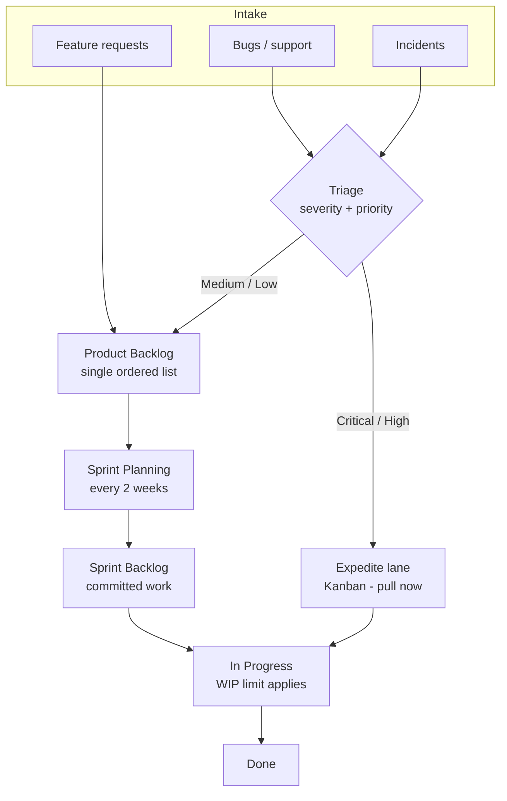

> Part of the [appco SDLC documentation](README.md) - original section 3.

# 3. Recommended Methodology

### 3.1 Recommendation

> **We adopt Scrum for planned product work, and Kanban for unplanned operational work, on a single shared board.** Sprints are **two weeks**. We start with a simplified Scrum (§3.6) and add ceremony only when the team feels the absence of it.

### 3.2 Why Scrum for planned feature development

Planned feature work has a property that suits Scrum well: it can be *scoped in advance*. We can look at a list of desired features, choose a coherent subset, commit to it for a fixed period, and be judged on whether we delivered it.

The sprint boundary gives us four things we currently lack:

1. **A planning trigger** — a recurring, unavoidable moment where priorities are re-decided with the Product Owner present.
2. **A commitment** — a small, explicit set of work the team believes it can finish. This is how estimation accuracy is learned: by comparing commitment to outcome, sprint after sprint.
3. **A demo deadline** — work has to be showable, which is a powerful forcing function against "90% done" tasks.
4. **A stable window** — mid-sprint, the team is protected from re-prioritisation. This is the main protection against context-switching, which is the largest silent productivity cost in small teams.

### 3.3 Why Kanban for support, maintenance, and urgent work

Unplanned work has the opposite property: it cannot be scoped in advance. Production incidents, urgent customer bugs, and small support requests arrive when they arrive. Forcing them into sprint commitments produces two bad outcomes: either the sprint is constantly broken, or urgent work waits for the next sprint boundary.

Kanban handles this correctly because it is **flow-based, not batch-based**: work is pulled when capacity exists, prioritised continuously, and limited by work-in-progress (WIP) caps rather than by a time box.

| Property | Scrum | Kanban |
|---|---|---|
| Unit of planning | Sprint (fixed time box) | Individual item |
| Commitment | Sprint goal + selected items | None; continuous flow |
| Re-prioritisation | At sprint boundary | Any time |
| Key control | Sprint capacity | WIP limit |
| Best for | Feature development, roadmap work | Bugs, support, incidents, ops |
| Main metric | Sprint goal completion, velocity | Cycle time, work item age |

### 3.4 The hybrid, without extra complexity

The hybrid is simpler than it sounds. **One board, one backlog, two lanes of behaviour:**

*Both lanes feed the same "In Progress" column and the same Definition of Done. The difference is only how work is selected: sprint items are chosen at planning; expedite items are pulled immediately when triage says Critical or High.*

Rules that keep the hybrid from becoming chaos:

1. **Capacity reservation.** We reserve **15–25% of each sprint's capacity** for unplanned work. If it is not used, the team pulls the next backlog item. This is far more honest than pretending unplanned work does not exist and then missing the sprint goal every time.
2. **One expedite item at a time.** At most one Critical item may pre-empt sprint work per developer. A second Critical item means we have a systemic problem, and that becomes a retrospective topic.
3. **Expedited work is still tracked.** Even a 15-minute hotfix gets an issue, a PR, and a board entry. Untracked work is invisible work, and invisible work destroys planning accuracy.
4. **No parallel boards.** Two boards means two places to look and one of them is always stale.

### 3.5 Sprint length: two weeks

**Recommended: two weeks. MUST be fixed and consistent** — the length matters far less than never changing it.

| Length | Pros | Cons | Verdict for us |
|---|---|---|---|
| 1 week | Very fast feedback; small batches | Ceremony overhead ~14% of time; too short for anything substantial; planning fatigue | Too costly |
| **2 weeks** | **~7% ceremony overhead; long enough for meaningful slices; short enough that a bad plan costs little; matches most stakeholder attention spans** | Needs discipline to break work down | **Recommended** |
| 3–4 weeks | Low ceremony overhead; fits large features without breakdown | Feedback too slow; plans drift; discourages the breakdown skill we most need to learn | Rejected for now |

The strongest argument for two weeks with an inexperienced team: **a bad sprint plan costs at most two weeks.** That is a cheap way to learn planning.

### 3.6 Simplified Scrum first, then mature

Start here (Phase 1–2 of adoption):

| Practice | Start with | Mature into |
|---|---|---|
| Sprint planning | 1 hour: pick items, agree a goal | 2 hours: capacity-based, with refined and estimated backlog |
| Estimation | T-shirt sizes (S/M/L/XL) | Story points (1,2,3,5,8,13) with velocity tracking |
| Stand-up | 10 min, 3 questions, in person or on a call | 10 min, board-driven, focused on flow and blockers |
| Refinement | Ad-hoc, PO + Tech Lead before planning | 1 hour mid-sprint session with the whole team |
| Review | Informal demo on a call | Structured demo with stakeholders and recorded feedback |
| Retrospective | 30 min, "keep / stop / start" | 45 min, rotating formats, tracked actions |
| Definition of Done | 6 checkboxes | Full DoD (§11.2) incl. monitoring and docs |
| Sprint goal | Optional | Mandatory, single sentence, agreed by the team |

### 3.7 Scrum events

Assumed team size: 4–8 people. Times scale down for smaller teams.

---

#### 3.7.1 Product Backlog Refinement

| Field | Detail |
|---|---|
| **Purpose** | Make upcoming backlog items ready for planning: clarify, split, estimate, identify dependencies. |
| **Participants** | Product Owner (required), Technical Lead (required), 1–2 Developers on rotation, QA (as needed), Designer (when UI work is upcoming) |
| **Frequency / Duration** | Once per sprint, mid-sprint. 45–60 minutes. **MUST NOT** exceed 10% of sprint capacity. |
| **Inputs** | Prioritised backlog items for the next 1–2 sprints |
| **Output** | Items meeting the **Definition of Ready** (§11.1): clear goal, acceptance criteria, estimate, dependencies noted |
| **Where it lands** | GitHub Issues updated; Project fields `Estimate`, `Priority`, `Status = Ready for Sprint` |

**Common mistakes**

- Refining the entire backlog. Refine only ~1.5 sprints ahead; anything further out will change.
- Designing the solution in detail during refinement. Refinement answers *what and why*; the *how* belongs to design (§5 Phase 4) and to the developer doing the work.
- Skipping refinement, then spending sprint planning arguing about requirements. Planning should be *selection*, not *discovery*.
- Only the PO and Tech Lead ever attending — the people doing the work never get a say and estimates become imposed rather than owned.

---

#### 3.7.2 Sprint Planning

| Field | Detail |
|---|---|
| **Purpose** | Decide what the team will deliver this sprint and roughly how. |
| **Participants** | Whole delivery team + PO (required), Scrum Facilitator (required) |
| **Duration** | 1–2 hours for a two-week sprint. Hard timebox. |
| **Inputs** | Refined, ordered backlog; team capacity (leave, holidays, support duty); previous sprint velocity |
| **Output** | (a) A one-sentence **Sprint Goal**; (b) a Sprint Backlog — issues assigned to the sprint iteration in the Project; (c) known risks and dependencies |

**Structure (recommended two-part split):**

- **Part 1 — What (40 min).** PO presents priorities. Team pulls items until capacity is reached. Team agrees the Sprint Goal.
- **Part 2 — How (30–60 min).** For each item, the team briefly discusses approach and creates technical sub-tasks where useful. Confirm each item meets Definition of Ready.

**Capacity rule of thumb for a new team:** available days × 0.6 (meetings, review, support, context-switching) × 0.8 (unplanned-work reserve). Refine using actual velocity after 3–4 sprints.

**Common mistakes**

- Committing to 100% of capacity. There is no slack for review, support, or the unexpected, so the sprint fails by design.
- Planning items with no acceptance criteria — the team will discover mid-sprint that everyone imagined a different feature.
- Skipping the Sprint Goal. Without it, a sprint is just a list, and there is no basis for trade-offs when things go wrong.
- The Tech Lead assigning all tasks. Pull beats push: people commit harder to work they chose.
- Treating the plan as a contract. It is a forecast; when reality differs, adjust and say so.

---

#### 3.7.3 Daily Stand-up

| Field | Detail |
|---|---|
| **Purpose** | Synchronise the team, surface blockers within 24 hours, adjust the day's plan toward the Sprint Goal. |
| **Participants** | Delivery team (required). PO/stakeholders **MAY** listen, **SHOULD NOT** direct. |
| **Duration** | **10–15 minutes maximum.** Same time every working day. |
| **Output** | Blockers named with an owner; board reflects reality |

**Format** — walk the board right-to-left (closest-to-done first), or each person answers:
1. What did I complete since yesterday? (link the issue)
2. What will I complete today?
3. What is blocking me or likely to block me?

**Common mistakes**

- Turning it into a status report to the manager. It is a coordination meeting *for the team*.
- Solving problems in the meeting. Note the problem, name who will discuss it after, move on. ("Let's take that offline" is a real technique, not a brush-off.)
- Running 30+ minutes. If it consistently overruns, the team is too large or discussions are not being deferred.
- Saying "same as yesterday" for three days without flagging a blocker. Work item age is a signal — use it (§15).
- Attendance requirement for remote/async teams: an async written stand-up in a chat thread is an acceptable substitute; the timebox becomes "posted before 10:00".

---

#### 3.7.4 Development and Review (the sprint itself)

Not a meeting — this is the bulk of the sprint, and its rules are in §5 Phase 6 (development workflow) and §5 Phase 7 (pull requests).

| Field | Detail |
|---|---|
| **Purpose** | Build, review, and verify the committed work |
| **Participants** | Developers, QA, Designer, Tech Lead |
| **Duration** | Roughly sprint length minus ceremony |
| **Output** | Merged, tested, deployed increments; updated board; updated docs |

**Common mistakes**

- Everyone starting a different item on day one, so everything is 80% done on the last day and nothing ships. Prefer swarming: finish items, then start new ones. Apply a WIP limit (see §7.4).
- Leaving all code review to the last two days.
- Silently expanding scope inside an issue instead of opening a new one.

---

#### 3.7.5 Sprint Review / Demonstration

| Field | Detail |
|---|---|
| **Purpose** | Show the working increment, gather feedback, adapt the backlog. |
| **Participants** | Team, PO, Scrum Facilitator, invited stakeholders |
| **Duration** | 45–60 minutes for a two-week sprint |
| **Inputs** | Deployed increment (on **Preview or Production**, not a local machine) |
| **Output** | Feedback captured as new/updated GitHub Issues; backlog re-prioritised; acceptance decision on completed items |

**Structure:** PO restates the sprint goal (5 min) → team demos completed items (25 min) → feedback and discussion (15 min) → PO outlines what is next (5 min).

**Common mistakes**

- Demoing from a developer's laptop. If it is not deployed, it is not done (§11.2).
- Demoing incomplete work to look busy. Show only items meeting the DoD; mention the rest verbally.
- Slides instead of software. Show the running system.
- Not capturing feedback into issues — feedback said out loud and not written down is feedback lost.
- Treating it as an approval gate the team must pass. It is a conversation, not an exam.

---

#### 3.7.6 Sprint Retrospective

| Field | Detail |
|---|---|
| **Purpose** | Improve how the team works. |
| **Participants** | Delivery team + Scrum Facilitator. **PO may attend if trust is high; managers by invitation only.** |
| **Duration** | 45 minutes |
| **Output** | **1–3 improvement actions, each with a named owner and a target sprint.** Added to the backlog as issues labelled `process`. |

**Simple starting format (Keep / Stop / Start):** silent writing (5 min) → grouping (5 min) → discussion of top themes (20 min) → choose 1–3 actions with owners (10 min) → review previous retro's actions (5 min).

**Common mistakes**

- No actions, or ten actions. Both mean nothing changes.
- Never reviewing the previous retro's actions — the fastest way to make the team stop caring.
- Blaming individuals. Ask what in the *system* made the mistake easy to make.
- Cancelling it when the sprint went badly. That is exactly the sprint that needed it.
- Managers present and dominating, which turns honesty off completely.

---

### 3.8 Ceremony summary

| Event | Frequency | Duration | Required participants | Primary output |
|---|---|---|---|---|
| Backlog refinement | 1× per sprint | 45–60 min | PO, Tech Lead, 1–2 devs | Items meeting Definition of Ready |
| Sprint planning | 1× per sprint (day 1) | 1–2 h | Whole team, PO | Sprint goal + sprint backlog |
| Daily stand-up | Daily | 10–15 min | Delivery team | Blockers surfaced |
| Sprint review | 1× per sprint (last day) | 45–60 min | Team, PO, stakeholders | Feedback as issues; acceptance |
| Retrospective | 1× per sprint (last day) | 45 min | Delivery team | 1–3 owned actions |

