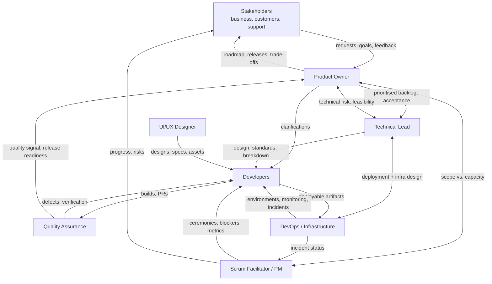

> Part of the [appco SDLC documentation](README.md) - original section 4.

# 4. Team Roles and Responsibilities

### 4.1 Roles are hats, not people

In a small team, one person wears several hats. That is normal and expected. What matters is that **for every activity, exactly one person knows they are accountable for it.** The failure mode we are avoiding is not "too few people" — it is "everyone assumed someone else was doing it".

Practical combinations for a team of 4–8:

| Team size | Typical assignment |
|---|---|
| 3–4 people | Tech Lead also acts as DevOps and Scrum Facilitator; PO is a founder or account manager; developers do their own QA with a cross-check rule (nobody QAs their own work) |
| 5–8 people | Dedicated PO; Tech Lead separate from Scrum Facilitator (facilitator can be a rotating developer); one developer owns DevOps ~20% of their time; one part-time QA |
| 8+ people | Split into two teams per product; dedicated QA and DevOps |

**Rules that hold regardless of size:**

- **MUST:** Nobody approves their own pull request when another qualified reviewer exists.
- **MUST:** Nobody is the only person who can deploy to production. At least two people hold the access and know the procedure.
- **SHOULD:** The person who wrote a feature is not the only person who tests it.

### 4.2 Role definitions

#### Product Owner (PO)

*Owns: what we build and in what order. Accountable for value.*

| Responsibility | Detail |
|---|---|
| Backlog ownership | Maintains a single, ordered product backlog in the GitHub Project |
| Prioritisation | Decides relative priority; is the tie-breaker when stakeholders disagree |
| Requirements | Writes or approves user stories, business rules, and acceptance criteria |
| Acceptance | Accepts or rejects completed work against acceptance criteria |
| Stakeholder interface | Single point of contact for business requests; shields the team from direct channel requests |
| Availability | **MUST** be reachable within one working day for clarifications during a sprint |
| Release scope | Decides what goes into a release and approves production deployment from a business standpoint |

**Does not:** assign tasks to individuals, estimate on the team's behalf, or change scope mid-sprint without agreement.

#### Project Manager / Scrum Facilitator

*Owns: that the process runs and that obstacles get removed. Accountable for flow, not for content.*

| Responsibility | Detail |
|---|---|
| Ceremonies | Schedules and facilitates planning, stand-up, review, retrospective |
| Board hygiene | Ensures the Project board reflects reality; chases stale items |
| Impediments | Tracks blockers to resolution; escalates when needed |
| Process coaching | Teaches the process to new members; guards against process erosion and process bloat |
| Reporting | Produces sprint and roadmap views for stakeholders (§7.5) |
| Metrics | Maintains the metrics in §15 and brings them to retrospectives |
| Risk & dependency tracking | Maintains cross-repository and cross-team dependencies |

**Does not:** decide technical approach, decide priority, or assign work to individuals (the team pulls).

#### Technical Lead

*Owns: technical coherence and quality. Accountable for the architecture holding together.*

| Responsibility | Detail |
|---|---|
| Architecture | Approves significant technical designs; owns ADRs (§14.4) |
| Standards | Defines and maintains coding standards, branching rules, and review standards |
| Technical breakdown | Converts features into technical tasks; identifies technical risk and spikes |
| Review | Final reviewer for high-risk changes (security, data model, integrations, migrations) |
| Estimation support | Facilitates estimation; challenges unrealistic estimates in both directions |
| Mentoring | Grows the team's capability; pairs on hard problems |
| Technical debt | Maintains the technical-debt register and argues for its budget each sprint |
| CODEOWNERS | Maintains ownership mapping per repository (§6.4) |

#### Developers

*Own: the implementation and its quality. Accountable for what they merge.*

| Responsibility | Detail |
|---|---|
| Implementation | Build features and fixes according to acceptance criteria |
| Tests | Write and maintain automated tests for their changes (**MUST** for new logic) |
| Self-review | Review own diff before requesting review |
| Peer review | Review teammates' PRs — **review takes priority over starting new work** |
| Board updates | Keep issue status current; raise blockers same-day |
| Estimation | Estimate their own work honestly, including uncertainty |
| Documentation | Update README, API docs, and runbooks affected by their change |
| Deployment verification | Confirm their change works in the target environment after deploy |

#### UI/UX Designer

| Responsibility | Detail |
|---|---|
| Research | User flows, problem framing, usability input during discovery |
| Design | Wireframes, mockups, prototypes, interaction and empty/error states |
| Design system | Maintains shared components and design tokens; coordinates with the `shared-ui` repository |
| Handover | Provides specs, assets, and states before development starts (a Definition of Ready item for UI work) |
| Review | Reviews implemented UI against the design; approves visual PRs |
| Accessibility | Ensures contrast, keyboard navigation, and semantic structure are specified |

#### Quality Assurance (QA)

| Responsibility | Detail |
|---|---|
| Test strategy | Defines what is tested where (§5 Phase 8) |
| Test cases | Derives test cases from acceptance criteria |
| Exploratory testing | Finds what scripted tests cannot |
| Regression | Maintains and runs the regression suite before releases |
| Bug reporting | Files reproducible, well-documented bugs (§19.5) |
| Release verification | Runs the staging test pass and post-deployment smoke tests |
| Automation | Grows automated E2E coverage over time |

*If there is no dedicated QA:* the DoD requires that a **different** team member than the author verifies acceptance criteria on staging before an item is Done.

#### DevOps / Infrastructure Owner

| Responsibility | Detail |
|---|---|
| CI/CD | Builds and maintains GitHub Actions workflows and reusable workflows |
| Environments | Provisions and maintains dev/staging/production; configures GitHub Environments and protection rules |
| Secrets | Owns secret storage, scoping, and rotation (§9.5) |
| Runners | Manages self-hosted runners, labels, groups, and isolation (§9) |
| Monitoring | Sets up health checks, error tracking, alerting, log collection (§13) |
| Backups | Ensures backups exist **and are periodically restore-tested** |
| Deployment execution | Owns the deployment mechanism; performs or supervises production releases |
| Incident support | First responder for infrastructure incidents |

#### Stakeholders

| Responsibility | Detail |
|---|---|
| Provide context | Business goals, constraints, deadlines, regulatory needs |
| Submit requests | Through the defined intake path (§5 Phase 1) — **not** by direct message to a developer |
| Participate | Attend sprint reviews; give feedback on the increment |
| Decide | Business trade-offs when the PO escalates |
| Accept | Formal sign-off for major releases where required |

### 4.3 Responsibility matrix (RACI)

**R** = Responsible (does the work) · **A** = Accountable (single owner, final say) · **C** = Consulted (input sought before) · **I** = Informed (told after)

| Activity | PO | Scrum Facilitator | Tech Lead | Developers | Designer | QA | DevOps | Stakeholders |
|---|---|---|---|---|---|---|---|---|
| Idea intake & initial triage | **A/R** | C | C | I | I | I | I | R |
| Requirement definition & approval | **A/R** | I | C | C | C | C | I | C |
| Business priority / backlog order | **A/R** | C | C | I | I | I | I | C |
| Technical design & architecture | C | I | **A/R** | R | C | I | C | I |
| UI/UX design | C | I | C | C | **A/R** | C | I | C |
| Task breakdown | C | C | **A/R** | R | I | C | C | I |
| Task estimation | C | C | **A** | **R** | C | C | C | I |
| Coding | I | I | C | **A/R** | I | I | I | I |
| Code review | I | I | **A** | **R** | C (UI) | I | C (workflows) | I |
| Automated test creation | I | I | C | **A/R** | I | **R** | I | I |
| Manual / exploratory testing | C | I | I | C | C | **A/R** | I | I |
| User acceptance testing | **A/R** | C | I | I | C | R | I | **R** |
| Release scope decision | **A/R** | C | C | I | I | C | C | C |
| Deployment approval (production) | **A** | I | **R** | I | I | C | **R** | I |
| Deployment execution | I | I | C | I | I | I | **A/R** | I |
| Production monitoring | I | I | C | C | I | I | **A/R** | I |
| Incident detection & triage | C | I | **A** | R | I | C | **R** | I |
| Incident resolution | I | C | **A** | **R** | I | C | R | I |
| Post-incident review | C | **R** | **A** | R | I | R | R | I |
| Release communication | **A/R** | R | C | I | I | I | C | **I** |
| Process change (this document) | C | **R** | **A** | C | C | C | C | I |
| Security policy & secret rotation | I | I | **A** | C | I | I | **R** | I |
| Technical debt prioritisation | **A** | C | **R** | C | I | I | C | I |

**Reading the matrix:** production deployment is the clearest example of the split. The PO is **accountable** for the business decision to release; the Tech Lead and DevOps are **responsible** for judging technical readiness and executing it. The GitHub `production` Environment enforces this by requiring an approval from a named reviewer group (§8.4).

### 4.4 Communication flow

*Two rules make this diagram real: (1) business requests enter through the Product Owner, not through direct messages to developers; (2) the Scrum Facilitator communicates progress outward so developers are not interrupted for status.*

