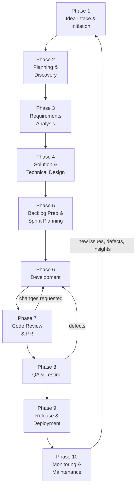

> Part of the [appco SDLC documentation](../README.md) - complete phase list below.

# 5. Complete SDLC Phases

### 5.0 Overview

*Phases 1–5 happen mostly outside the sprint (or in refinement); phases 6–9 are the sprint loop; phase 10 runs continuously and feeds back into intake. Small changes skip phases 2 and 4 entirely — see the sizing rule below.*

**Sizing rule — how much process does this change need?**

| Change size | Phases 1–4 effort | Example |
|---|---|---|
| **Trivial** (copy change, config value, dependency bump) | Issue only. No discovery, no design. | Change a label; bump a patch version |
| **Small** (< 2 days, one repo, no schema change) | Issue with acceptance criteria. Design decided in the PR. | Add a filter to an existing list |
| **Medium** (< 1 sprint, may touch 2 repos or the schema) | Issue + acceptance criteria + short technical note + design if UI | New report screen with a new endpoint |
| **Large / Epic** (multi-sprint, cross-repo, new subsystem) | Full Phases 1–4 including project brief, ADR, diagrams, rollback plan | Subscription billing |

**MUST:** anything that changes the database schema, touches authentication/authorisation, handles money, or affects data retention goes through at least the Medium path regardless of code size.

## Phases in this folder

| # | Phase | Document |
|---|---|---|
| 1 | Idea Intake and Project Initiation | [01-idea-intake.md](01-idea-intake.md) |
| 2 | Planning and Discovery | [02-planning-discovery.md](02-planning-discovery.md) |
| 3 | Requirements Analysis | [03-requirements-analysis.md](03-requirements-analysis.md) |
| 4 | Solution and Technical Design | [04-solution-design.md](04-solution-design.md) |
| 5 | Backlog Preparation and Sprint Planning | [05-backlog-sprint-planning.md](05-backlog-sprint-planning.md) |
| 6 | Development - The Daily Process | [06-development.md](06-development.md) |
| 7 | Code Review and Pull Requests | [07-code-review-pr.md](07-code-review-pr.md) |
| 8 | Quality Assurance and Testing | [08-qa-testing.md](08-qa-testing.md) |
| 9 | Release and Deployment | [09-release-deployment.md](09-release-deployment.md) |
