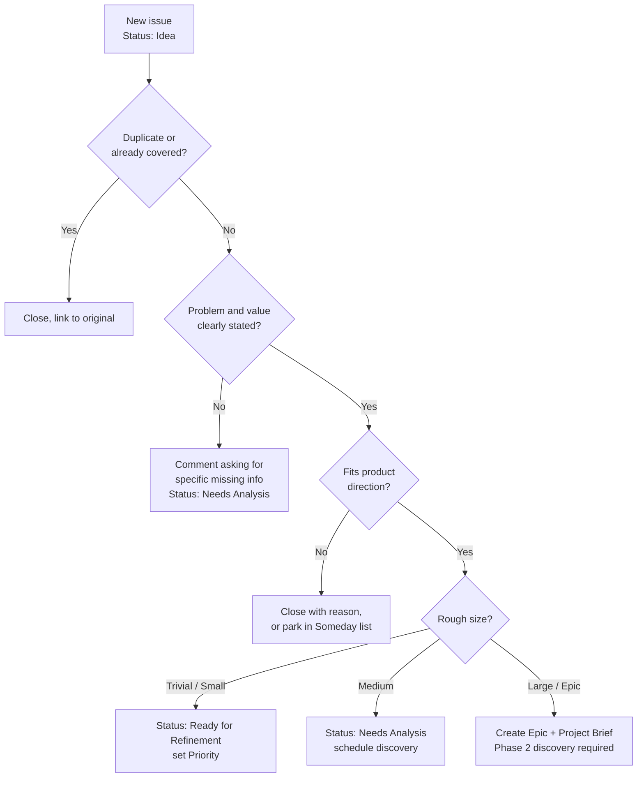

> Part of the [appco SDLC documentation](../../README.md) - [phase overview](00-overview.md), Phase 1.

# Phase 1: Idea Intake and Project Initiation

**Goal:** get every request into one place, in a comparable form, with enough information to decide whether it is worth analysing further.

#### 1.1 Where ideas come from

| Source | Channel | Lands as |
|---|---|---|
| Business / stakeholder request | Issue in the product's `-docs` or main repo, using the *Feature Request* template | Issue, `type: feature`, `Status: Idea` |
| Customer support | Support agent files an issue (or PO batches them weekly) | Issue, `type: bug` or `feature` |
| Bug found internally or by QA | *Bug Report* template in the affected repository | Issue, `type: bug`, severity label |
| Developer improvement / tech debt | *Technical Task* template | Issue, `type: tech-debt` |
| Production monitoring / incident | Auto-created or manually created issue with `source: production` | Issue, `type: bug` or `incident` |
| Security finding | Private security advisory or `type: security` issue with restricted visibility | Advisory (§6.9) |

**MUST:** requests do not enter the process through direct messages, calls, or hallway conversation. If a request arrives that way, the receiver's job is to say "please file it" or to file it themselves and link the requester. This is the single highest-value habit change in this entire document.

#### 1.2 What an incoming request must contain

The Feature Request issue template (§19.1) captures:

| Field | Why it matters |
|---|---|
| **Problem statement** | What is wrong today. Written as a problem, not a solution. |
| **Business justification** | Revenue, cost, risk, compliance, or retention — why now |
| **Expected users** | Who benefits, and roughly how many |
| **Business value** | Expected outcome, quantified if possible ("cuts 3 h/week of manual work") |
| **Requested priority** | Requester's view — advisory only; the PO decides the real priority |
| **Known risks** | Legal, data, reputation, technical |
| **Dependencies** | Other teams, vendors, systems, or work items |
| **Rough scope** | In scope / explicitly out of scope |
| **Deadline & its nature** | Real external deadline vs. preference — these are treated very differently |

#### 1.3 Initial triage

The PO (with Tech Lead) triages new items **at least weekly**, ideally as a 20-minute slot before refinement.

*Triage is a decision, not a queue. Every triaged item leaves with a status and a priority — "we will look at it later" is recorded as `Someday` or closed, never left ambiguous.*

#### 1.4 Priority scale

| Priority | Meaning | Response expectation |
|---|---|---|
| `P0 — Critical` | Production down, data loss, security breach, revenue blocked | Immediate; interrupts sprint (§12) |
| `P1 — High` | Major function broken or committed deadline at risk | Current or next sprint |
| `P2 — Medium` | Important but schedulable | Next 2–4 sprints |
| `P3 — Low` | Nice to have, small improvement | Backlog; pulled when capacity allows |

#### 1.5 Output of Phase 1

| Request size | Output artefact |
|---|---|
| Trivial / Small | An approved backlog item (GitHub Issue) with priority set, `Status: Ready for Refinement` |
| Medium | Issue plus a short analysis note in the issue body |
| Large | **Project Brief** (§19.1) as an issue or a Markdown file in the product `-docs` repository, plus an **Epic** issue |

**Exit criteria (MUST):** the item has a title, a stated problem, a stated value, a priority, an owner (PO), and a Project status. Items failing this after two weeks are closed as `stale` — reopening is cheap; an infinite ambiguous backlog is not.

