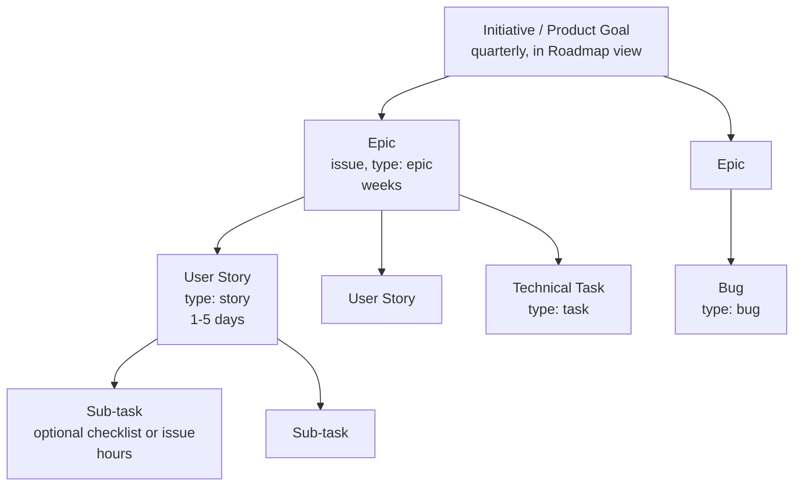

> Part of the [appco SDLC documentation](../../README.md) - [phase overview](00-overview.md), Phase 5.

# Phase 5: Backlog Preparation and Sprint Planning

**Goal:** convert approved requirements into actionable, estimated, prioritised GitHub Issues, and select a coherent set for the sprint.

#### 5.1 The work breakdown hierarchy

| Level | Size guide | Tracked as | Lives where |
|---|---|---|---|
| Initiative | 1 quarter+ | Project `Parent Epic` grouping or milestone | Roadmap view |
| Epic | 2–8 weeks | Issue with `type: epic`, sub-issues linked | Product Project |
| Story / Task / Bug | 0.5–5 days | Issue | Sprint backlog |
| Sub-task | < 1 day | Checklist item in the issue (preferred) or a sub-issue | Inside the issue |

**SHOULD:** prefer checklists inside an issue over sub-issues. Sub-issues are for work assigned to a *different person* or *different repository*.

#### 5.2 Cross-repository work

A story often spans repos (backend endpoint + frontend screen). Two options:

| Approach | How | Use when |
|---|---|---|
| **Single issue in the "home" repo** (recommended default) | One story issue in the backend repo; PRs in both repos reference it (`Refs org/repo#123`) | The work is small and done by one person |
| **Parent + child issues** | Story in the product `-docs` repo (or backend), with sub-issues in each affected repo | Different people/repos, or the work must be tracked and reviewed separately |

**MUST:** issues spanning repositories record the **deployment order** in the issue body (e.g. "backend must deploy before frontend; the endpoint is additive so this is safe").

#### 5.3 From requirement to issue — the checklist

For each item entering the backlog:

1. **Choose the type** and apply the correct issue template.
2. **Write the title** in the imperative and specific: ✗ "Subscription bug" ✓ "Plan downgrade charges full price instead of prorating".
3. **Body from the template**, with acceptance criteria.
4. **Labels:** `type:`, `priority:`, `area:` (e.g. `area: billing`), and `good-first-issue` where applicable.
5. **Link relationships:** parent epic, blocked-by/blocks, related issues.
6. **Add to the product's GitHub Project** and fill the fields (§7.2).
7. **Repository association:** create it in the repo where most of the work happens.
8. **Milestone:** assign if it belongs to a named release.
9. **Estimate** in refinement.
10. **Validate against the Definition of Ready** (§11.1) before it can be pulled into a sprint.

#### 5.4 Estimation

Estimates measure **complexity + uncertainty + effort**, not hours. We estimate so we can *forecast* and *detect when an item is too big*, not to measure people.

**Start here — T-shirt sizing** (adoption Phase 1–2):

| Size | Meaning | Rough duration | Action |
|---|---|---|---|
| **XS** | Trivial, understood completely | < 2 hours | Fine |
| **S** | Simple, familiar pattern | ~half a day | Fine |
| **M** | Normal task, some thinking required | 1–2 days | Fine |
| **L** | Complex or partly unknown | 3–5 days | Consider splitting |
| **XL** | Large or highly uncertain | > 1 week | **MUST** split, or run a spike first |

**Mature into — story points** (adoption Phase 2+), modified Fibonacci:

| Points | Meaning |
|---|---|
| 1 | Trivial, no unknowns, no coordination |
| 2 | Simple, well understood |
| 3 | Normal work, minor unknowns |
| 5 | Complex, several parts, or moderate unknowns |
| 8 | Large; borderline — prefer splitting |
| 13 | Too large for a sprint. **MUST** split or spike. |

Anchor points to a reference story the team agrees on ("adding a validated field to an existing form = 2"), and re-anchor every few months.

**How to run estimation (Planning Poker, 2 minutes per item max):**
1. Tech Lead or PO reads the item and acceptance criteria.
2. Everyone picks a size privately, then reveals simultaneously.
3. If estimates are within one step, take the higher and move on.
4. If they differ widely, the highest and lowest explain (30 s each) — the disagreement usually reveals a missing requirement, which is the real value of the exercise. Re-vote once.
5. Still disagreeing? Take the higher value and note the uncertainty. Do not average, do not vote three times.

**Rules**

- **MUST NOT** convert points to hours or use them to compare individuals or teams.
- **MUST NOT** use velocity as a performance target. Velocity is a *capacity forecast*, and any metric used as a target gets gamed (§15.3).
- **SHOULD:** the person likely to do the work has the loudest voice on its estimate, but the whole team estimates.
- Bugs **MAY** be left unestimated at first; if bug work is a large share of a sprint, estimate them so capacity planning stays honest.

#### 5.5 Prioritisation

The PO owns the order. A simple, defensible method for a growing team is **value vs. effort**:

| | Low effort | High effort |
|---|---|---|
| **High value** | **Do first** | Plan properly (Epic, discovery) |
| **Low value** | Do when convenient / batch | **Do not do** — say no explicitly |

Add two overrides: (1) anything `P0`/`P1` jumps the queue; (2) work that unblocks other work is prioritised above its own value.

#### 5.6 Sprint planning mechanics in GitHub

1. Ensure the Project has an **Iteration field** named `Sprint` with two-week iterations configured.
2. Filter the backlog view to `Status = Ready for Sprint`, sorted by `Priority`.
3. Compute capacity: team days minus leave, minus the unplanned-work reserve (§3.4).
4. Pull items top-down until estimates reach capacity.
5. Set `Sprint` = current iteration on each selected item; set `Status = Ready for Sprint`.
6. Agree the **Sprint Goal** and record it in the Project's sprint view description or a pinned issue.
7. Assign owners where obvious; leave the rest unassigned for pull.
8. Record known risks/dependencies as comments or `Blocked` field values.

#### 5.7 Output of Phase 5

- A Sprint Goal (one sentence)
- A sprint backlog of estimated, ready issues assigned to the iteration
- Board reflecting the plan
- Known risks and dependencies recorded

