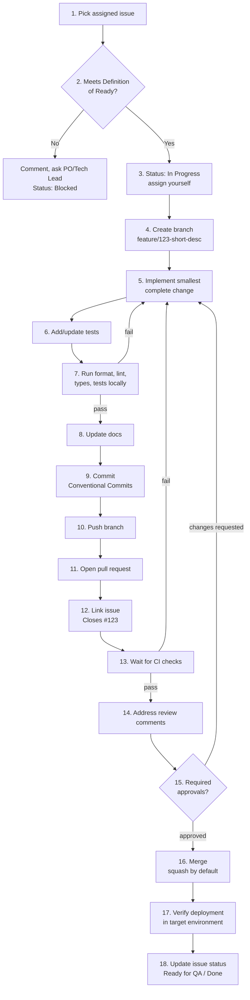

> Part of the [appco SDLC documentation](../../README.md) - [phase overview](00-overview.md), Phase 6.

# Phase 6: Development — The Daily Process

**This is the section developers use every day.** Everything before it is preparation; everything after it is verification.

#### 6.1 The 18-step workflow



---

**Step 1 — Select an assigned GitHub Issue**

Pull from the sprint board, top of the list, respecting priority. **Before starting anything new, check whether there is a PR waiting for your review** — unblocking a teammate finishes work; starting new work only creates more WIP.

**Step 2 — Confirm the Definition of Ready**

Read the acceptance criteria. If anything is unclear, ask **now** in an issue comment, not after two days of building the wrong thing. Set `Status: Blocked` with a reason if you cannot proceed. Nobody is ever penalised for asking a clarifying question; guessing is the expensive behaviour.

**Step 3 — Move the issue to "In Progress"**

Assign yourself and set `Status: In Progress`. **MUST:** only one item in progress per person at a time (WIP limit), except when genuinely blocked and waiting.

**Step 4 — Create a branch**

Branch **from `nightly`**, which is the integration branch (§10):

```bash
git checkout nightly
git pull origin nightly
git checkout -b feature/142-subscription-plan-change
```

**Branch naming (MUST):** `<type>/<issue-number>-<short-kebab-description>`

| Prefix | Use for | Example |
|---|---|---|
| `feature/` | New functionality | `feature/142-subscription-plan-change` |
| `fix/` | Bug fix (non-urgent) | `fix/187-proration-rounding-error` |
| `hotfix/` | Urgent production fix (§12) | `hotfix/203-checkout-500-error` |
| `chore/` | Maintenance, dependencies, config | `chore/151-bump-laravel-11` |
| `docs/` | Documentation only | `docs/160-deployment-runbook` |
| `refactor/` | Restructuring without behaviour change | `refactor/172-extract-billing-service` |
| `test/` | Test-only additions | `test/168-subscription-e2e` |
| `release/` | Release preparation, if used (§10) | `release/1.4.0` |

Keep it under ~60 characters, lowercase, hyphen-separated. The issue number is what makes the branch traceable — **MUST** include it.

**Step 5 — Implement the smallest complete change**

"Smallest complete" means: it works, it is safe to merge, and it does not need a companion PR to be sensible. Signals you should stop and split:

- The diff exceeds ~400 changed lines (excluding lockfiles, generated code, and fixtures)
- You are touching a second, unrelated concern
- You catch yourself writing "while I was in there…" in the PR description

Unrelated improvements you notice → open a new issue and move on. Yak-shaving inside a feature branch is the main cause of unreviewable PRs.

**Step 6 — Add or update automated tests**

**MUST:** new business logic ships with tests. **MUST:** a bug fix ships with a test that fails without the fix. Details in §8.

**Step 7 — Run checks locally**

Run what CI will run, before pushing. Every repository **MUST** expose a single command that runs the full local check set (a `Makefile`, `composer check`, `npm run verify`, `just check` — whatever fits the stack), documented in the README.

```bash
npm run format          # or: make fmt
npm run lint
npm run typecheck
npm test
```

Pushing code that fails a check CI would have caught wastes both CI minutes and reviewer attention.

**Step 8 — Update related documentation**

README, setup steps, env var list, API docs, runbooks, ADR if a notable decision was made. **MUST:** a new environment variable is documented in `.env.example` **and** in the deployment notes in the same PR — missing env vars are one of the most common deployment failures.

**Step 9 — Commit using Conventional Commits**

**MUST** use [Conventional Commits](https://www.conventionalcommits.org/):

```
<type>(<optional scope>): <short imperative description>

<optional body: what and why, not how>

<optional footer: Refs #142 / BREAKING CHANGE: ...>
```

| Type | Use for | Version impact (§9.6) |
|---|---|---|
| `feat:` | New user-facing capability | MINOR |
| `fix:` | Bug fix | PATCH |
| `docs:` | Documentation only | none |
| `style:` | Formatting, no code meaning change | none |
| `refactor:` | Restructure without behaviour change | none |
| `perf:` | Performance improvement | PATCH |
| `test:` | Tests only | none |
| `build:` | Build system, dependencies | none |
| `ci:` | CI/CD configuration | none |
| `chore:` | Other maintenance | none |
| `revert:` | Reverts a previous commit | contextual |
| `feat!:` / `BREAKING CHANGE:` footer | Incompatible change | MAJOR |

Examples:

```
feat(billing): add plan change endpoint

Adds POST /api/subscriptions/{id}/plan supporting upgrade and
downgrade. Upgrades apply immediately with proration; downgrades
are scheduled for the end of the period per BR-03.

Refs #142
```

```
fix(billing): prorate downgrades instead of charging full price

Downgrade calculated the new price from the period start rather
than the change date, overcharging mid-period downgrades.

Closes #187
```

Rules: subject in the imperative ("add", not "added"), ≤ 72 characters, no trailing period. Commit small and often locally; the squash merge (§7.7) produces the clean history.

**Step 10 — Push the branch**

```bash
git push -u origin feature/142-subscription-plan-change
```

Push at least daily, even if unfinished — work that exists only on a laptop is work that can be lost, and nobody can help with it.

**Step 11 — Open a pull request**

**Target the `nightly` branch** — never `main` directly (§10). Open it as a **draft** if it is not ready for review; a draft PR is a good way to get early CI feedback and to make progress visible. Fill in the PR template (§19.7) — details in §5 Phase 7.

**Step 12 — Link the pull request to the issue**

**MUST** include a closing keyword in the PR description:

```
Closes #142
```

Use `Closes` / `Fixes` / `Resolves` for the issue the PR completes; `Refs #142` for related issues it does not close. For cross-repository links: `Closes appco/product-a-backend#142` (note: cross-repo closing keywords require appropriate permissions; if it does not work, link manually and close the issue by hand).

**Step 13 — Wait for automated checks**

CI runs (§8.1). **MUST NOT** request review while checks are failing — fix them first; reviewer time is the scarcest resource in the process.

**Step 14 — Address review comments**

- Respond to every comment: fix it, or explain why not. Silence reads as ignoring.
- Push fixes as new commits (do not force-push mid-review; it destroys the reviewer's "changes since last review" view). Squashing happens at merge.
- Re-request review explicitly when ready.
- Disagreement is fine — discuss it; if it stalls, the Tech Lead decides in one comment and the team moves on.

**Step 15 — Obtain required approvals**

Default: **one approval** for standard changes; **two, one being the Tech Lead**, for high-risk changes (auth, payments, migrations, infrastructure, shared libraries). CODEOWNERS enforces the specialist reviewer automatically (§6.4).

**Step 16 — Merge using the approved strategy**

| Strategy | When | Result |
|---|---|---|
| **Squash and merge** (default, **SHOULD**) | Nearly all feature/fix PRs | One clean commit on `main`, message = PR title (so the **PR title MUST follow Conventional Commits**) |
| **Merge commit** | Release branches; long-lived branch integration | Preserves branch topology |
| **Rebase and merge** | Small, already-clean commit series worth preserving | Linear history, no merge commit |

Delete the branch after merge (GitHub can do this automatically — enable it per repo).

**Step 17 — Confirm deployment to the correct environment**

Merging to `nightly` triggers an automatic deployment to the **Preview** environment (§8.2). **MUST:** the author opens Preview and verifies their change actually works there, then hands it to the tester. "It merged" is not "it works".

**Step 18 — Move the issue to the correct status**

| Situation | Status |
|---|---|
| Merged, deployed to dev, needs QA | `Ready for QA` |
| QA in progress | `In QA` |
| Verified, waiting for release | `Ready for Deployment` |
| Live in production and verified | `Done` |

Project automation handles part of this (§7.8); the rest is a 10-second manual update.

#### 6.2 Daily rhythm

| Time | Activity |
|---|---|
| Start of day | Read notifications; **review pending PRs first**; check CI/alerts |
| Stand-up | 10 min; state blockers |
| Morning | Deepest work — implementation |
| Around midday | Push work in progress; open a draft PR if useful |
| Afternoon | Continue; respond to review comments on your PRs |
| End of day | Push everything; update issue status; note blockers on the issue |

#### 6.3 Keeping a branch current

Prefer rebasing while a branch is private (not yet reviewed):

```bash
git fetch origin
git rebase origin/nightly
# resolve conflicts, then:
git push --force-with-lease
```

Once review has started, prefer merging `nightly` into the branch instead, so reviewers keep a stable diff:

```bash
git fetch origin && git merge origin/nightly
```

**MUST NOT** use `git push --force` on a shared branch; `--force-with-lease` only, and only on your own branch.

#### 6.4 Common developer mistakes this process prevents

| Mistake | Prevented by |
|---|---|
| Working on the wrong thing | Step 2 (Definition of Ready) |
| Nobody knows what you are doing | Step 3 (status update) |
| Untraceable change | Steps 4, 9, 12 (issue number in branch, commit, PR) |
| Unreviewable 3,000-line PR | Step 5 (smallest complete change) |
| Regression on the next change | Step 6 (tests) |
| CI red for everyone | Step 7 (local checks first) |
| Deployment fails on a missing env var | Step 8 (document config in the same PR) |
| Nobody can tell what shipped | Steps 9, 16 (Conventional Commits → generated release notes) |
| "Works on my machine" | Step 17 (verify in the environment) |

