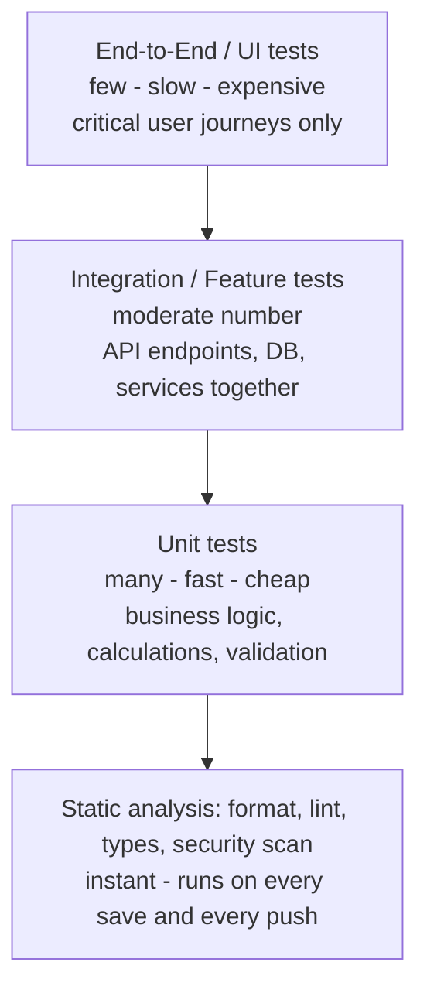
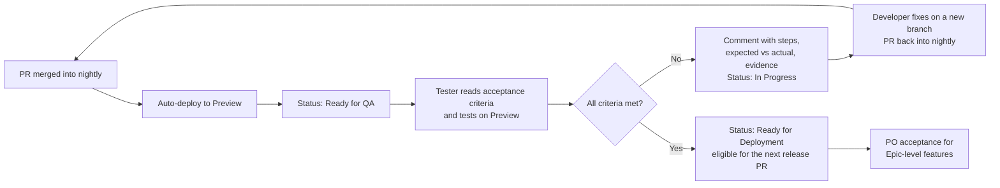

> Part of the [appco SDLC documentation](../../README.md) - [phase overview](00-overview.md), Phase 8.

# Phase 8: Quality Assurance and Testing

**Goal:** find defects as early and as cheaply as possible, and make it impossible for known-broken code to reach production.

#### 8.1 The testing pyramid

*Read bottom-up: most of the confidence should come from the cheap, fast layers. A suite that is 80% E2E tests is slow, flaky, and quietly stops being trusted — and an untrusted suite is worse than no suite.*

#### 8.2 Test layers

| Layer | What it checks | Tooling examples | Speed | Required? |
|---|---|---|---|---|
| **Formatting** | Consistent style | Prettier, PHP-CS-Fixer, gofmt, black | instant | **MUST** |
| **Linting** | Bug-prone patterns, unused code | ESLint, PHPStan, Ruff, golangci-lint | seconds | **MUST** |
| **Type checking** | Type correctness | TypeScript, mypy, PHPStan level N | seconds | **MUST** where the language supports it |
| **Unit tests** | Pure logic in isolation | Jest/Vitest, PHPUnit, pytest, go test | seconds | **MUST** for new business logic |
| **Integration / feature tests** | Components together, incl. real DB | PHPUnit feature tests, supertest, pytest + test DB | tens of seconds | **MUST** for new API endpoints |
| **API contract tests** | Request/response shape, status codes, auth | Schema validation against OpenAPI | seconds | **SHOULD** |
| **UI component tests** | Component rendering and behaviour | Testing Library, Vitest | seconds | **SHOULD** for shared components |
| **End-to-end tests** | Full user journey in a browser | Playwright, Cypress | minutes | **SHOULD** for critical paths only |
| **Security testing** | Vulnerable deps, secrets, code patterns | Dependabot, CodeQL, secret scanning, `npm audit` | seconds–minutes | **MUST** (automated) |
| **Performance testing** | Response times under load | k6, JMeter, Lighthouse CI | minutes | **MAY** — before major releases and for known-critical paths |
| **Accessibility testing** | WCAG basics | axe-core in E2E | seconds | **SHOULD** for user-facing UI |
| **Manual exploratory** | The things automation cannot imagine | Human + staging | ~hours per sprint | **SHOULD** |
| **User acceptance testing (UAT)** | Does it solve the business problem? | PO/stakeholder on staging | varies | **MUST** for Epic-level features |
| **Regression testing** | Old things still work | Automated suite + a manual checklist | automated | **MUST** before production |
| **Smoke testing** | Is the deployment alive and functional? | Scripted HTTP checks post-deploy | < 1 min | **MUST** after every deployment |

#### 8.3 What runs where

| Stage | Runs | Duration target | Blocking? |
|---|---|---|---|
| **Local (pre-commit)** | Format + lint on changed files (via a pre-commit hook — **SHOULD**, keep it fast) | < 5 s | Yes, locally |
| **Local (pre-push / manual)** | Full lint, types, unit tests | < 2 min | Developer discipline |
| **Pull request → `nightly`** | Format, lint, types, unit, integration, build, dependency review, secret + code scanning | **< 10 min** | **MUST block merge** |
| **After merge to `nightly`** | Full suite incl. E2E against the Preview deployment | < 20 min | Blocks promotion to `main` |
| **Before Preview deployment** | Build artifact verification; migration dry run where feasible | — | **MUST block deploy** |
| **After Preview deployment** | Smoke tests + full E2E + manual tester pass + UAT | — | **MUST block the release PR to `main`** |
| **Release PR `nightly` → `main`** | Re-verify the exact artifact's checks passed; confirm tester sign-off and backup | — | **MUST block merge** |
| **After production deployment** | Smoke tests + health checks + error-rate watch for 15–30 min | < 5 min automated | **MUST trigger rollback on failure** |
| **Nightly / scheduled** | Full E2E, performance, security scan, backup restore verification | — | Alerts, does not block |

**MUST:** a red required check blocks the merge button, mechanically via branch protection. **MUST NOT** merge by disabling a required check. If a check is wrong, fix the check in its own PR.

**Flaky tests:** a test that fails intermittently is worse than no test, because it teaches the team to ignore red. Policy: a test that flakes twice in a week is **quarantined** (skipped with a linked issue, `priority: P2`) and fixed within one sprint. **MUST NOT** add blanket retries to hide flakiness.

#### 8.4 Coverage

Coverage is a **signal**, not a target. Rules:

- **SHOULD:** new code in business-logic areas is covered; the PR check reports coverage of the diff.
- **MUST NOT:** set a global coverage percentage gate early on. It produces tests written to touch lines rather than to assert behaviour.
- **SHOULD:** protect critical modules (billing, auth, permissions) with a higher informal standard and a Tech Lead review of test quality.

#### 8.5 QA process per item

**Bug found during QA of the same item:** comment on the original issue and reopen it — do **not** create a separate bug. It never left the sprint.
**Bug found after the item was accepted:** file a new bug issue linked to the original.

#### 8.6 Test data and environments

- **MUST NOT** use production personal data on Preview or locally. Use generated or anonymised data.
- **SHOULD:** maintain a seed script per repo that produces a realistic dataset in one command.
- **SHOULD:** Preview data volume roughly reflects production; performance issues invisible at 50 rows appear at 500,000.
- Third-party integrations use sandbox credentials on Preview; **MUST NOT** point Preview at a live payment provider or send real customer email from it.

