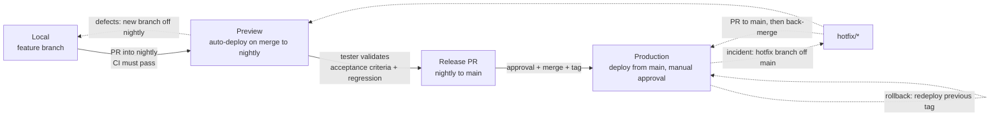
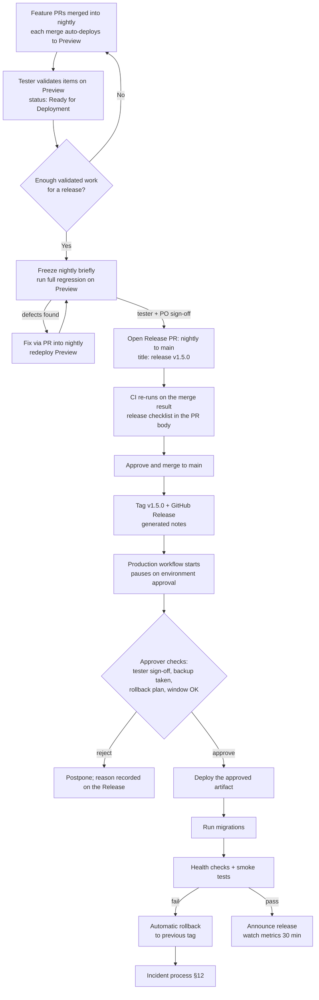

> Part of the [appco SDLC documentation](../../README.md) - [phase overview](00-overview.md), Phase 9.

# Phase 9: Release and Deployment

**Goal:** get tested changes into production predictably, with the ability to undo them.

#### 9.1 Environments

We run **two shared environments per product**, each bound to a branch:

| Environment | GitHub Environment | Branch | Purpose | Data | Trigger | Who can deploy |
|---|---|---|---|---|---|---|
| **Local** | — | working branch | Individual development | Seeded / fake | Manual | Developer |
| **Preview** | `preview` | **`nightly`** | Integration + the environment testers validate on. Production-like configuration. | Anonymised, production-like volume | **Automatic** on every merge to `nightly` | Automated (no human) |
| **Production** | `production` | **`main`** | Real users | Real | Release PR merged to `main` → tag → **manual approval** | `@appco/release-approvers` only |

**MUST:** Preview matches production in runtime versions, configuration structure, and deployment mechanism. A preview environment that differs from production tests the wrong thing, and every difference becomes a production surprise.

**Optional third environment.** Some products will eventually want a separate long-lived **Staging** (e.g. for a customer UAT that must not be disturbed by nightly merges, or for load testing). Add it only when Preview is genuinely contended — the cost is another server, another set of secrets, and another thing that drifts. Until then, Preview *is* the staging environment.

**Naming note.** "Preview" here means the shared, always-on environment fed by `nightly`. It is not the per-PR ephemeral preview that some hosting platforms create automatically. If your frontend host (Vercel, Netlify, Cloudflare Pages) does give per-PR previews, use them — they are excellent for design review — but they do **not** replace the `nightly` Preview environment, because they do not exercise the merged, integrated state that the tester signs off.

#### 9.2 Environment promotion



*The same build artifact moves right through the environments. **MUST NOT** rebuild between Preview and Production — a rebuild is a different artifact, and then the tester validated something that is not what shipped. The production workflow downloads the artifact that the `nightly` pipeline built and the tester approved.*

#### 9.3 The release process



**Release PR convention (MUST).** Production changes reach `main` through a single **release pull request** from `nightly`, titled `release: v1.5.0`. That PR is the record of the release: its body carries the release checklist (§19.9), the list of included issues, and the tester's sign-off. It is reviewed by the Tech Lead and approved by the PO. This is why `main` needs no direct pushes and no long-lived divergence.

#### 9.4 Recommended release strategy for our team

| Stage | Recommendation | Reasoning |
|---|---|---|
| **Preview (`nightly`)** | **Continuous deployment** — every merge to `nightly` deploys automatically, no approval | Fast feedback; forces the deploy path to be reliable; testers always look at the current integrated state. If this deploy is not trustworthy, production never will be |
| **Production (`main`)** | **Manual approval**, deployed from the tag created on merge of the release PR | The approval is the single control point where a human confirms business readiness. Everything before it is automated so the human decision is the *only* manual step |
| **Cadence** | **At least once per sprint**, and any time a validated, low-risk item is valuable | Regular small releases beat quarterly big ones (P8) |
| **Release window** | Prefer **Tuesday–Thursday mornings**; avoid Fridays and the day before a holiday | Not superstition: it is about having the people who wrote the code awake and available if something breaks |
| **Emergency hotfix** | `hotfix/*` branched from `main`, PR straight to `main`, expedited approval, **then back-merged into `nightly`** (§12.5) | Incidents do not respect windows, and the fix must not be lost on the next release |

**Progression.** Start with the Preview deploy manual (a `workflow_dispatch` button) for the first week or two, while the deployment scripts stabilise. As soon as it has run cleanly ~10 times, switch it to automatic on merge. Keep production manual indefinitely — the cost is one click; the benefit is a deliberate human checkpoint on the only environment that has real users.

**Risk to be honest about.** A two-branch model means `nightly` can drift ahead of `main` and accumulate a large, risky release. Mitigations we adopt: release at least once per sprint; keep the release PR small enough to read; and treat "the release PR has 60 commits" as a signal at retrospective, not as normal.

#### 9.5 Release checklist

Before creating the release (full version in §19.9):

- [ ] All issues in the milestone are `Ready for Deployment` or explicitly moved out
- [ ] Preview regression pass complete and signed off by the tester; no open Critical/High defects
- [ ] UAT sign-off from the PO where applicable
- [ ] Release notes drafted and readable by non-developers
- [ ] Migrations reviewed; reversibility confirmed or explicitly accepted
- [ ] Database backup taken and **verified restorable**
- [ ] Rollback procedure written down for *this* release
- [ ] Config/env var changes applied to production
- [ ] Third-party/dependency changes verified
- [ ] Stakeholders notified of timing
- [ ] Someone who knows the change is available for 1 hour after deployment

#### 9.6 Versioning — Semantic Versioning

**MUST** use [SemVer](https://semver.org/): `MAJOR.MINOR.PATCH`

| Increment | When | Example |
|---|---|---|
| **MAJOR** | Breaking change: incompatible API change, removed feature, migration requiring user action | `1.4.2 → 2.0.0` |
| **MINOR** | New backwards-compatible functionality | `1.4.2 → 1.5.0` |
| **PATCH** | Backwards-compatible bug fix | `1.4.2 → 1.4.3` |
| **Pre-release** | Release candidate on staging | `1.5.0-rc.1` |

Tags are `v`-prefixed: `v1.5.0`. Because commits follow Conventional Commits, version bumps and release notes can be **generated** (`release-please`, `semantic-release`, or `git-cliff`) — recommended from adoption Phase 3.

Per-repository versioning: each repository has its own version. Products with tightly coupled repos **MAY** additionally track a product-level version in the `-docs` repo. Do not force artificial version lockstep across repositories; it creates meaningless releases.

#### 9.7 When to create a GitHub Release

| Situation | Tag? | GitHub Release? |
|---|---|---|
| Every merge to `nightly` / Preview deployment | No | No |
| **Merge of the release PR into `main`** | **Yes — MUST** (`vX.Y.Z`) | **Yes — MUST** |
| Hotfix to production | Yes (PATCH bump) | Yes |
| Library/shared package publish | Yes | Yes |

The Release is the human-readable record of what went to production and when. It is what the team reads at 3 a.m. to answer "what changed today?".

#### 9.8 Release notes

Generated from Conventional Commits, then **edited for humans**. Structure:

```markdown
## v1.5.0 — 2026-08-04

# New
- Store owners can change their subscription plan from account settings (#142)

# Fixed
- Downgrades are now prorated correctly instead of charging the full period (#187)

# Changed
- Plan comparison table now shows annual pricing by default (#151)

# Internal
- Upgraded framework to 11.x (#160)

# Upgrade notes
- Requires migration `2026_08_01_add_plan_change_log`. Runs automatically; ~2 s on current data volume.
- New environment variable `BILLING_WEBHOOK_SECRET` must be set before deployment.
```

**MUST:** the "Upgrade notes" section exists whenever there is a migration, a new env var, or a manual step.

#### 9.9 Database migrations

| Rule | Detail |
|---|---|
| **MUST** be in version control alongside the code that needs them | Never applied manually against production |
| **MUST** run automatically as part of deployment | Manual steps get forgotten |
| **MUST** be tested on a staging database of realistic size | A migration that takes 2 s on 100 rows can lock a table for minutes on 5M rows |
| **SHOULD** be backwards compatible with the previous code version | Enables zero-downtime deploys and rollback (§4.3 expand/contract) |
| **MUST NOT** drop columns or tables in the same release that stops using them | Wait at least one release |
| **MUST** take a verified backup before any destructive or irreversible migration | Non-negotiable |
| **SHOULD** split large data backfills out of the deployment into a separate, resumable job | A deploy blocked on a 40-minute backfill is an outage |

#### 9.10 Rollback

**Every production deployment MUST have a stated rollback method before it starts.**

| Method | How | Time | Use when |
|---|---|---|---|
| **Redeploy previous artifact** (preferred) | Re-run the production workflow with the previous version tag | 2–5 min | Code-only issues |
| **Revert the PR** | `git revert`, then release a PATCH | 15–30 min | The change is isolated and a clean forward fix is safe |
| **Feature flag off** | Disable the flag | seconds | Feature-flagged work — the fastest rollback that exists |
| **Restore from backup** | Restore DB snapshot | 30 min – hours, **with data loss** | Last resort after data corruption |

**MUST:** if a migration is not reversible, the rollback plan says so explicitly and describes the alternative (usually: forward-fix only, plus a backup taken immediately before deployment).

**Automatic rollback:** the production workflow **SHOULD** roll back automatically when post-deployment health checks fail (§8.3), then raise an incident (§12).

#### 9.11 Stakeholder communication

| When | Who | Channel | Content |
|---|---|---|---|
| Release scheduled | PO → stakeholders | Email / chat announcement | What is shipping, when, expected impact |
| Deployment starting | Automated | Team chat via workflow notification | Version, environment, actor |
| Deployment complete | Automated | Team chat + GitHub Release | Version, duration, health check result |
| User-visible change | PO | Product changelog / in-app notice | Written for users, not developers |
| Failure or rollback | DevOps/Tech Lead | Team chat, then incident process | What happened, current state, next step |

