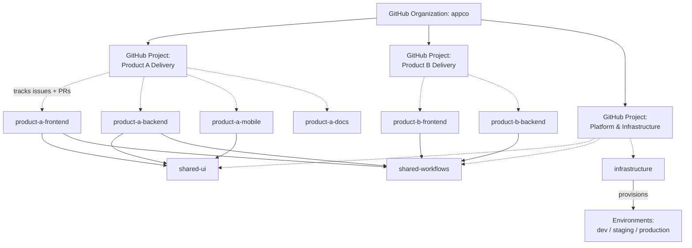

> Part of the [appco SDLC documentation](README.md) - original section 6.

# 6. GitHub Organization Structure

### 6.1 Principles

1. **One organization** for all products. Multiple orgs fragment access management, billing, shared workflows, and search.
2. **Repository names encode the product**, so that alphabetical listing groups a product's repositories together.
3. **Access is granted to Teams, never to individuals.** Individual grants are invisible and never get cleaned up when someone leaves.
4. **Default permission for organization members: `Read`.** Write is granted per team, per repository.

### 6.2 Example structure

```text
appco/                                  # GitHub Organization
│
├── product-a-frontend                  # Web client (React/Vue/etc.)
├── product-a-backend                   # API / server
├── product-a-mobile                    # iOS/Android app
├── product-a-docs                      # Product docs, ADRs, briefs, cross-repo issues
│
├── product-b-frontend
├── product-b-backend
├── product-b-docs
│
├── shared-ui                           # Design system / component library (versioned package)
├── shared-utils                        # Cross-product libraries
├── shared-workflows                    # Reusable GitHub Actions workflows + composite actions
│
├── infrastructure                      # IaC, server config, runner setup, environment definitions
├── engineering-handbook                # THIS document, coding standards, onboarding, policies
└── .github                             # Org-level defaults: profile, issue/PR templates, SECURITY.md
```

**Naming convention (MUST):** `<product>-<component>`, lowercase, hyphen-separated.
Shared code: `shared-<name>`. Organization-wide: no product prefix (`infrastructure`, `engineering-handbook`).

**The `.github` repository** is a GitHub feature, not a convention: files placed there become organization-wide defaults for any repository that lacks its own (issue templates, PR template, `CONTRIBUTING.md`, `SECURITY.md`, `CODE_OF_CONDUCT.md`). Set the templates there once instead of copying them into every repository.

### 6.3 Teams and permissions

| Team | Members | Default repository permission |
|---|---|---|
| `@appco/engineering` | All developers | `Write` on all product repos |
| `@appco/tech-leads` | Technical Lead(s) | `Maintain` on all repos |
| `@appco/admins` | Org owners (2–3 people) | `Admin` |
| `@appco/devops` | Infrastructure owners | `Admin` on `infrastructure`, `shared-workflows`; `Maintain` elsewhere |
| `@appco/qa` | QA members | `Write` (needs to open issues and PRs, run workflows) |
| `@appco/design` | Designers | `Triage` (issues, no code) |
| `@appco/product` | PO, PM | `Triage` |
| `@appco/product-a` | People working on Product A | `Write` on `product-a-*` |
| `@appco/product-b` | People working on Product B | `Write` on `product-b-*` |
| `@appco/release-approvers` | People who may approve production deploys | Used as the GitHub Environment reviewer group |

GitHub permission levels, briefly:

| Level | Can |
|---|---|
| `Read` | Clone, open issues, comment |
| `Triage` | + manage issues/PRs (labels, assignment, close) without write access to code |
| `Write` | + push branches, open PRs, run workflows |
| `Maintain` | + manage most repository settings (not destructive ones) |
| `Admin` | + everything, including deletion and branch-protection changes |

**MUST:** organization base permission = `Read`. **MUST:** at least two org owners (bus factor). **SHOULD:** require 2FA for all organization members. **SHOULD:** review team membership quarterly and on every departure.

### 6.4 CODEOWNERS

`.github/CODEOWNERS` in each repository. Auto-requests review from the right people and, combined with "Require review from Code Owners", makes specialist review mandatory where it matters.

```text
# Default owners for everything
*                           @appco/engineering

# Anything touching CI/CD or deployment requires DevOps review
/.github/workflows/         @appco/devops @appco/tech-leads
/infrastructure/            @appco/devops
Dockerfile                  @appco/devops
docker-compose*.yml         @appco/devops

# Data model and migrations
/database/migrations/       @appco/tech-leads
/app/Models/                @appco/tech-leads

# Security-sensitive areas
/app/Http/Middleware/       @appco/tech-leads
/app/Policies/              @appco/tech-leads
/config/auth.php            @appco/tech-leads

# Design system usage
/src/components/ui/         @appco/design @appco/engineering

# Documentation
/docs/                      @appco/tech-leads
*.md                        @appco/engineering
```

**SHOULD:** keep CODEOWNERS short. Owning everything specifically means the Tech Lead becomes a review bottleneck, which is the failure mode this is meant to prevent.

### 6.5 Secrets: where each kind lives

| Scope | Use for | Examples | Notes |
|---|---|---|---|
| **Organization secrets** | Shared across many repos | Container registry token, package registry token, Slack webhook, error-tracking DSN | **MUST** restrict to selected repositories, never "all repositories" for anything sensitive |
| **Repository secrets** | Repo-specific, environment-independent | Repo-scoped API keys for CI, code-coverage token | |
| **Environment secrets** | **All deployment credentials** | `SSH_HOST`, `SSH_USER`, `SSH_PRIVATE_KEY`, `DB_PASSWORD`, provider API keys | **MUST** — this is what makes protection rules meaningful, since a job cannot read them without passing the environment's approval gate |
| **Repository variables** | Non-secret configuration | `APP_URL`, `NODE_VERSION`, `DEPLOY_PATH` | Visible in logs; never for credentials |

**MUST:** production credentials exist **only** as `production` Environment secrets, with the environment limited to protected branches/tags and a required reviewer group. See §9.5 for rotation.

### 6.6 Issue templates

Stored as `.github/ISSUE_TEMPLATE/*.yml` (GitHub Issue Forms — structured fields beat free-text Markdown because they can be required and parsed). Set once in the org `.github` repo; override per repository where needed.

| File | Title | For |
|---|---|---|
| `feature_request.yml` | 💡 Feature request | New capability (§19.3) |
| `bug_report.yml` | 🐞 Bug report | Defects (§19.5) |
| `technical_task.yml` | 🔧 Technical task | Internal/technical work (§19.4) |
| `spike.yml` | 🔍 Research spike | Timeboxed investigation (§19.6) |
| `epic.yml` | 🎯 Epic | Large feature grouping (§19.2) |
| `incident.yml` | 🚨 Production incident | Incidents (§19.11) |
| `config.yml` | — | Disables blank issues; links to Discussions for questions |

Example `config.yml`:

```yaml
blank_issues_enabled: false
contact_links:
  - name: 💬 Question or idea
    url: https://github.com/orgs/appco/discussions
    about: Ask questions or float ideas here before filing an issue.
  - name: 🔒 Report a security vulnerability
    url: https://github.com/appco/product-a-backend/security/advisories/new
    about: Please report security issues privately, never as a public issue.
```

### 6.7 Pull request template

`.github/pull_request_template.md` — see §19.7. **SHOULD** be short enough that people actually fill it in; a template nobody completes is worse than none, because it trains people to ignore templates.

### 6.8 Discussions

| Use Discussions for | Use Issues for |
|---|---|
| Open questions with no defined work | Anything that will result in a change |
| RFCs and proposals before they become work | Approved work |
| Announcements, release highlights | Bugs |
| Q&A and knowledge sharing | Tasks |
| Retrospective themes (optional, org-level) | Actions from retrospectives |

Recommended: one **organization-level** Discussions space (in the `.github` or `engineering-handbook` repo) rather than per-repo, so conversations are findable in one place.

### 6.9 Security policy

`SECURITY.md` in the org `.github` repository, covering: how to report a vulnerability (private advisory link, security email), expected response time, supported versions, and disclosure expectations.

**MUST enable per repository:**

| Feature | Purpose |
|---|---|
| Dependabot alerts + security updates | Known vulnerable dependencies |
| Dependabot version updates (weekly, grouped) | Keeps dependencies from rotting into a giant upgrade |
| Secret scanning + **push protection** | Blocks committed credentials before they land |
| Code scanning (CodeQL) | Static security analysis on PRs |
| Private vulnerability reporting | Lets outsiders report safely |

**MUST NOT** file security vulnerabilities as public issues. Use a private security advisory.

### 6.10 Repository standards

Every repository **MUST** contain:

```text
repo/
├── .github/
│   ├── workflows/              # CI/CD
│   ├── CODEOWNERS
│   └── pull_request_template.md    # if it differs from the org default
├── docs/
│   ├── adr/                    # Architecture Decision Records
│   ├── architecture.md
│   └── deployment.md           # runbook: deploy, rollback, troubleshoot
├── .env.example                # every env var, documented, no real values
├── README.md                   # see §14.1
├── CHANGELOG.md                # generated from Conventional Commits
└── (source)
```

**Repository settings (MUST):**
- Description and topics filled in (`product-a`, `backend`, `laravel`) — makes org search usable
- A `nightly` branch created from `main` at repository setup, and branch protection / rulesets on **both** `main` and `nightly` (§7.8, §10.4)
- Default branch set to **`nightly`**, so new PRs target it automatically (§10.3)
- Squash merge only; auto-delete head branches on
- Issues enabled; wiki disabled (docs live in `/docs`, version-controlled with the code)

**Archiving:** when a repository is retired, add a deprecation notice at the top of the README pointing to the replacement, then **archive** (read-only) rather than delete. Deleting destroys history and breaks every link that ever referenced it. Prefix the description with `[ARCHIVED]`.

### 6.11 Shared workflows repository

`shared-workflows` holds reusable workflows and composite actions so that CI standards are defined once:

```text
shared-workflows/
├── .github/workflows/
│   ├── node-ci.yml            # reusable: lint, typecheck, test, build for Node
│   ├── php-ci.yml             # reusable: PHP equivalent
│   ├── deploy-ssh.yml         # reusable: artifact deployment over SSH
│   └── security-scan.yml      # reusable: dependency + secret + code scan
├── actions/
│   ├── setup-node-cached/     # composite action
│   └── notify-slack/
└── README.md                  # usage examples for each
```

Consuming repositories call them:

```yaml
jobs:
  ci:
    uses: appco/shared-workflows/.github/workflows/node-ci.yml@v1
    with:
      node-version: '22'
    secrets: inherit
```

**MUST:** pin reusable workflows and third-party actions to a tag or commit SHA, never `@main`. A moving reference means an upstream change can alter every pipeline in the organization without a review. **MUST:** `shared-workflows` requires Tech Lead + DevOps approval to merge — it is the highest-privilege repository in the organization.

### 6.12 Documentation repositories

| Repository | Contains |
|---|---|
| `engineering-handbook` | This SDLC, coding standards, onboarding, security procedures, template library — everything that is not product-specific |
| `<product>-docs` | Product briefs, cross-repo ADRs, requirement documents, cross-repository issues, product-level architecture |
| In-repo `/docs` | Anything specific to that codebase — setup, architecture, deployment, runbooks |

Rule of thumb: **documentation lives as close to the code it describes as possible.** Only genuinely cross-cutting material goes in a separate repository. Docs far from the code go stale silently.

### 6.13 How multiple repositories connect to one Project



*A GitHub Project (v2) is organization-scoped and can contain items from **any** repository in the organization. That is what lets a single "Product A Delivery" board show the frontend issue, the backend issue, and the mobile issue for one feature side by side — which is exactly what cross-repository products need and what per-repository boards cannot do.*

**Recommended Projects:**

| Project | Scope | Owner |
|---|---|---|
| `Product A Delivery` | All `product-a-*` repos | PO for Product A |
| `Product B Delivery` | All `product-b-*` repos | PO for Product B |
| `Platform & Infrastructure` | `shared-*`, `infrastructure` | Tech Lead / DevOps |
| `Roadmap` (optional) | Epics only, across all products | Leadership |

**SHOULD NOT** create a Project per repository — it recreates the fragmentation the Project is meant to solve.

