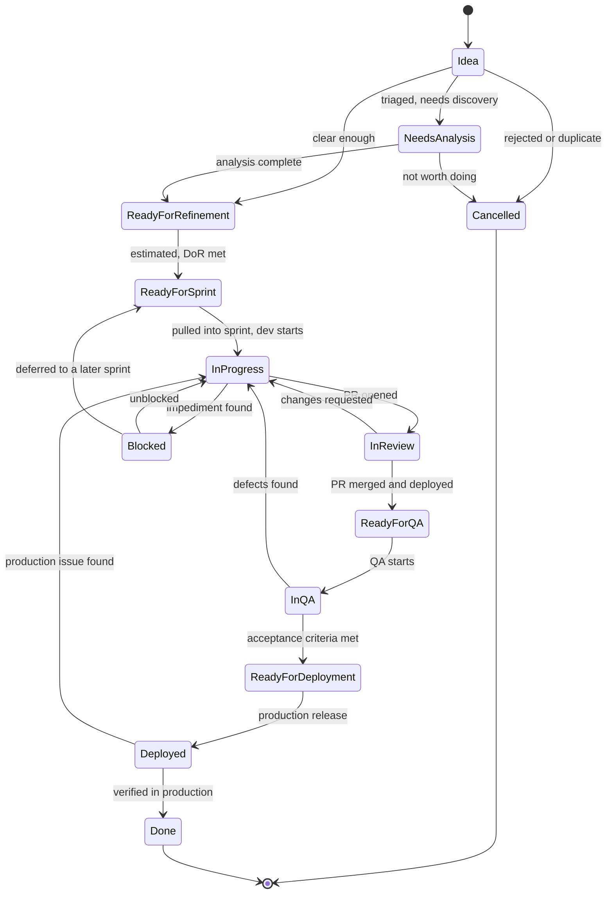

> Part of the [appco SDLC documentation](README.md) - original section 7.

# 7. GitHub Projects Configuration

### 7.1 What we are building

One Project per product, containing issues and pull requests from every repository of that product, with fields rich enough to support sprint planning, roadmapping, and release tracking — but no richer.

**Warning up front:** every field you add is a field somebody must fill in. Start with the fields marked **Phase 1** below; add the rest as the need becomes real.

### 7.2 Project fields

| Field | Type | Values | Purpose | Adopt in |
|---|---|---|---|---|
| **Title** | built-in | — | Issue title | Phase 1 |
| **Status** | Single select | See §7.3 | Where the work is | Phase 1 |
| **Priority** | Single select | `P0 Critical`, `P1 High`, `P2 Medium`, `P3 Low` | Order of work | Phase 1 |
| **Work Type** | Single select | `Feature`, `Bug`, `Tech Debt`, `Spike`, `Chore`, `Docs`, `Incident` | Filtering and reporting mix of work | Phase 1 |
| **Assignee** | built-in | People | Who is doing it | Phase 1 |
| **Repository** | built-in (auto) | — | Which repo — free, no maintenance | Phase 1 |
| **Sprint** | **Iteration** | 2-week iterations | Sprint assignment; enables burn-down and sprint views | Phase 2 |
| **Estimate** | Number *or* Single select | `1,2,3,5,8,13` or `XS…XL` | Capacity planning | Phase 2 |
| **Parent Epic** | Text or built-in sub-issue relation | Epic issue reference | Grouping and roadmap rollup | Phase 2 |
| **Target Date** | Date | — | Commitment or deadline | Phase 2 |
| **Product** | Single select | `Product A`, `Product B`, `Platform` | Only needed on multi-product boards | Phase 2 |
| **Start Date** | Date | — | Roadmap/timeline view | Phase 3 |
| **Milestone** | built-in | Repo milestone | Release grouping | Phase 3 |
| **Release** | Text or Single select | `v1.5.0` | Which release shipped it | Phase 3 |
| **Environment** | Single select | `Dev`, `Staging`, `Production` | Where the change currently lives | Phase 3 |
| **Reviewer** | Text/People | — | Only if review assignment needs tracking beyond GitHub's own | Phase 3 |
| **Blocked** | Single select | `No`, `Yes — internal`, `Yes — external` | Surfaces stuck work | Phase 3 |
| **Dependency** | Text | Issue refs | What must land first | Phase 3 |
| **Risk** | Single select | `Low`, `Medium`, `High` | Flags items needing extra design/review | Phase 4 |
| **Actual Effort** | Number | Days/points | Estimation calibration only — **MUST NOT** be used for individual performance | Phase 5 |

**Honest caution on `Actual Effort`:** it is genuinely useful for learning to estimate, and genuinely dangerous as a management metric. Adopt it only if the team wants it, and only aggregate it at the team level.

### 7.3 Statuses

Full set (adopt progressively):

| Status | Meaning | Who moves it here |
|---|---|---|
| `Idea` | Captured, not yet triaged | Anyone (auto on issue creation) |
| `Needs Analysis` | Triaged; requires discovery or more info | PO |
| `Ready for Refinement` | Analysed; needs estimation and acceptance criteria | PO |
| `Ready for Sprint` | Meets Definition of Ready; may be pulled | Team at refinement |
| `In Progress` | Actively being worked | Developer |
| `In Review` | PR open, awaiting review | Automation (PR opened) |
| `Ready for QA` | Merged into `nightly` and deployed to Preview | Automation (PR merged) |
| `In QA` | Being tested | QA |
| `Ready for Deployment` | QA passed; awaiting production release | QA / PO |
| `Deployed` | Live in production, pending final verification | Automation (deploy workflow) |
| `Done` | Verified in production; DoD met | PO / developer |
| `Blocked` | Cannot proceed | Anyone (**MUST** add a reason comment) |
| `Cancelled` | Will not be done | PO (**MUST** add a reason comment) |

**Start smaller (adoption Phase 1) — six statuses:**
`Backlog` → `Ready` → `In Progress` → `In Review` → `Testing` → `Done`, plus `Blocked`.

Then split `Backlog` into `Idea` / `Needs Analysis` / `Ready for Refinement` and `Testing` into `Ready for QA` / `In QA` / `Ready for Deployment` / `Deployed` when the team feels the ambiguity. **Do not start with thirteen statuses** — the board becomes an administrative chore and people stop updating it, which destroys the one thing a board is for.

### 7.4 Status flow and WIP limits



*Note the backward transitions — they are the honest part. Work moves backwards when review finds problems or QA finds defects, and the board must show that rather than pretending progress is linear.*

**WIP limits (SHOULD):**

| Column | Limit |
|---|---|
| `In Progress` | 1 per developer (2 absolute maximum) |
| `In Review` | 3 team-wide — if exceeded, the team reviews before writing new code |
| `Blocked` | 2 team-wide — more than that is a systemic problem for the stand-up |

GitHub Projects does not enforce WIP limits automatically; this is a team agreement checked at stand-up. That is sufficient — the point is the conversation, not the enforcement.

### 7.5 Views

A Project supports multiple saved views over the same items. Recommended set:

| View | Layout | Filter | Group / Sort | Used by / when |
|---|---|---|---|---|
| **1. Backlog** | Table | `-status:Done,Cancelled` and no sprint | Group by `Priority`, sort by priority | PO daily; refinement |
| **2. Current Sprint** | Board | `sprint:@current` | Columns = `Status` | Stand-up, daily work |
| **3. My Work** | Board or Table | `assignee:@me -status:Done` | By `Status` | Individual developers |
| **4. Team Board** | Board | `sprint:@current` | **Group by `Assignee`** | Spotting overload and idle capacity |
| **5. By Repository** | Table | current sprint | Group by `Repository` | Cross-repo coordination |
| **6. Roadmap** | Roadmap | `type:epic` | Date fields = `Start Date` / `Target Date`, group by `Product` | Stakeholders, quarterly planning |
| **7. Timeline / Gantt** | Roadmap | current quarter | Date fields set; markers = milestones | Delivery planning, dependencies |
| **8. Release** | Table | `milestone:v1.5.0` | Group by `Status` | Release readiness |
| **9. Bugs** | Table | `type:bug -status:Done` | Group by `Priority`, sort by created date | Bug triage; QA |
| **10. Blocked** | Table | `blocked:Yes*` | Sort by age | Scrum Facilitator daily |

Differences worth being explicit about:

- **Backlog vs. Sprint board.** The backlog is an *ordered list of everything not yet committed* — a table, because ordering matters. The sprint board is *only the committed work* — a board, because status flow matters. Mixing them produces a board with 200 cards nobody reads.
- **Team board vs. sprint board.** Same items, grouped by person instead of status. Answers "who has too much?" rather than "what is where?".
- **Repository view.** Answers "what is happening in the mobile app this sprint?" without a separate board.
- **Roadmap vs. Timeline.** Roadmap shows Epics over months for stakeholders; Timeline shows sprint-level items over weeks for the team.
- **Release view.** Filtered by milestone — the release readiness checklist, live.

### 7.6 Roadmap / Gantt-style planning, honestly

GitHub's **Roadmap layout** gives a Gantt-like horizontal timeline driven by `Start Date` and `Target Date`, with milestone markers and iteration shading.

Use it for:
- Communicating the *shape* of a quarter to stakeholders
- Spotting collisions (three Epics all targeting the same two weeks)
- Sequencing dependencies visually
- Tracking fixed external deadlines

Do **not** use it for:
- Task-level scheduling of individual developers
- Committing to dates for work that has not been refined
- Progress measurement — use the sprint board and Done items for that

**The trade-off, stated plainly.** Gantt charts assume the plan is knowable in advance; Agile assumes it is not. Both can be true at different zoom levels. Our convention:

| Horizon | Confidence | What we commit to |
|---|---|---|
| Current sprint | High | Specific items, specific sprint |
| Next 1–2 sprints | Medium | Epics in flight, approximate order |
| This quarter | Low | Themes and intentions with wide date ranges |
| Beyond a quarter | Speculative | Direction only, no dates |

**MUST:** roadmap items beyond the current sprint are labelled as *forecast*, not commitment, in any stakeholder communication. GitHub's roadmap does not know the difference; humans must state it.

### 7.7 Epics, hierarchy, and dependencies

**Parent/child.** Use GitHub's native **sub-issues** to link stories to their Epic. This gives an automatic progress bar on the Epic and rolls up in the Project. Where sub-issues are not suitable (cross-repo, mixed types), keep a task list in the Epic body:

```markdown
# Child issues
- [ ] appco/product-a-backend#142 — Plan change API endpoint
- [ ] appco/product-a-frontend#88 — Plan selection UI
- [ ] appco/product-a-backend#143 — Proration calculation
- [ ] appco/product-a-docs#12 — Update billing help article
```

**Dependencies.** GitHub has no first-class dependency field. Convention:

- In the issue body: `**Blocked by:** #142` and `**Blocks:** #150`
- Set the Project `Blocked` field and `Dependency` text field
- Cross-repository: use full references (`appco/product-a-backend#142`) — GitHub renders these as links with live status
- The Scrum Facilitator reviews the Blocked view daily

**Milestones.** Milestones are per-repository in GitHub, which is awkward for multi-repo products. Convention:

| Need | Use |
|---|---|
| Release grouping within one repository | Repository **Milestone** (`v1.5.0`) |
| Release grouping across repositories | Project **`Release`** field (`v1.5.0`) — set it in all repos' items |
| Time-boxed sprint | Project **`Sprint`** iteration field, **not** milestones |

**MUST NOT** use milestones as sprints. The iteration field exists for that and works across repositories.

### 7.8 Automation

GitHub Projects has **built-in workflows** (Project → Settings → Workflows). Enable these first — they are free and remove most manual board updating:

| Built-in workflow | Configure to |
|---|---|
| Item added to project | Set `Status` = `Idea` |
| Item reopened | Set `Status` = `In Progress` |
| Item closed | Set `Status` = `Done` |
| Pull request merged | Set `Status` = `Ready for QA` |
| Code changes requested | Set `Status` = `In Progress` |
| Code review approved | (leave; merge will move it) |
| Auto-add to project | Add all new issues from the product's repositories |
| Auto-archive items | Archive items `Done` for more than 30 days (keeps the board fast) |

For anything beyond that, use **GitHub Actions with the Projects API**. Example — set `Status` to `In Review` when a PR is opened, and stamp the `Environment` field after a deployment:

```yaml
# .github/workflows/project-automation.yml
name: Project automation

on:
  pull_request:
    types: [opened, ready_for_review]

jobs:
  move-linked-issues:
    runs-on: ubuntu-latest
    permissions:
      contents: read
    steps:
      - uses: actions/add-to-project@v1.0.2   # pin to a released tag
        with:
          project-url: https://github.com/orgs/appco/projects/1
          github-token: ${{ secrets.PROJECT_AUTOMATION_TOKEN }}
```

**Note:** organization Project automation needs a token with `project` scope — a fine-grained PAT or a GitHub App installation token stored as an **organization secret**. The default `GITHUB_TOKEN` cannot write to organization Projects.

**SHOULD:** automate only transitions that are unambiguous (PR opened, PR merged, issue closed). Statuses that require judgement (`Ready for Deployment`, `Done`) stay manual — automating a judgement produces a board that lies.

### 7.9 Sprint iteration setup

1. Project → Settings → new field → **Iteration**, named `Sprint`.
2. Duration: **2 weeks**. Start on a Monday.
3. Generate ~6 iterations ahead; name them `Sprint 12 (Aug 4–15)`.
4. Configure breaks for company holidays rather than skipping numbers.
5. Set the **Current Sprint** view filter to `sprint:@current` so it never needs manual updating.

At sprint boundary: items not finished are moved to the next iteration (**not** silently carried, and **not** re-estimated — carrying over is data, and a story carried over three sprints is a signal, not a formality).

