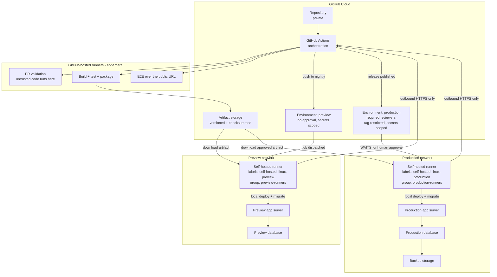

> Part of the [appco SDLC documentation](README.md) - original section 9.

# 9. GitHub Runner and Server Deployment Design

### 9.1 The problem

GitHub Actions needs a machine to run on, and deployment needs that machine to reach our servers. How we connect those two things is the **single highest-security-risk decision in this entire document**. A mistake here does not cause a bug — it causes an attacker running arbitrary code as our deployment user on production.

### 9.2 Comparison of the four options

| | **A. GitHub-hosted only** | **B. GitHub-hosted + SSH deploy** | **C. Self-hosted in the deployment network** | **D. Self-hosted for everything** |
|---|---|---|---|---|
| **How it works** | Everything runs on GitHub's ephemeral VMs; deployment via a provider API | Build on GitHub VM, then `ssh` into our server to deploy | Build on GitHub VM; a runner installed inside our network pulls the artifact and deploys locally | All jobs, including PR validation, run on our own machines |
| **Setup effort** | Lowest | Low | Medium | Medium |
| **Cost** | Per-minute (2,000 free min/month on Free; more on Team/Enterprise) | Per-minute | Per-minute for builds + our server cost | Our server cost only |
| **Server must accept inbound connections** | No | **Yes — SSH port must accept GitHub's IP ranges** | **No — the runner connects outbound to GitHub** | No |
| **Secrets exposure** | Provider API token | **Private SSH key stored in GitHub** | Short-lived runner registration token; no long-lived server key in GitHub | Same as C |
| **Access to internal networks / private DB** | No | Only via the SSH hop | **Yes — natural** | Yes |
| **Risk of untrusted PR code on a privileged machine** | None | None | **None if configured correctly (§9.4)** | **HIGH — this is the dangerous one** |
| **Maintenance burden** | None | Low | Runner patching, disk cleanup, monitoring | Highest |
| **Best for** | Static sites, serverless, PaaS | Simple VPS deployments, small teams | Servers with no public SSH, private networks, our production target | Special hardware, large private compute needs |

### 9.3 Recommendation

> **Build and validate on GitHub-hosted runners. Deploy through self-hosted runners installed on (or beside) the target servers — one runner per environment, in separate runner groups, never running pull-request code.**
>
> If self-hosted runners are not yet available, **Option B (SSH from a GitHub-hosted runner) is an acceptable starting point** provided the SSH key is an environment secret, the deployment user is restricted (§9.6), and the server firewall allows only GitHub's published IP ranges.

Why this split:

1. **PR code is untrusted.** Anyone who can open a PR can propose a workflow change or a malicious test. That code must run somewhere disposable — a GitHub-hosted VM destroyed after the job.
2. **Deployment needs privilege.** Writing to `/var/www`, reloading services, and running migrations require access we must not hand to a build job.
3. **Ephemeral build, privileged deploy** gives us both: the risky work happens in a sandbox, and the privileged work only ever executes an artifact that already passed review, CI, and (for production) human approval.
4. **Outbound-only.** A self-hosted runner connects *out* to GitHub over HTTPS. Nothing needs to accept inbound connections from the internet — a strictly better security posture than opening SSH.

### 9.4 The rule that matters most

> **A self-hosted runner MUST NOT execute workflows triggered by pull requests, and MUST NOT be attached to a public repository.**

The reason, stated plainly: a workflow triggered by a pull request runs the *pull request's* version of the workflow file and the *pull request's* code. On a self-hosted runner, that means a contributor — or anyone who compromises a contributor's account — gets arbitrary code execution on a machine that can reach production. Self-hosted runners are also **not ephemeral by default**: files, credentials, and caches written by one job are visible to the next.

**Mandatory configuration:**

| Control | Setting |
|---|---|
| Trigger restriction | Deployment workflows trigger only on `push` to `nightly`, `release: published`, or `workflow_dispatch` — **never** `pull_request` or `pull_request_target` |
| Repository visibility | Self-hosted runners attach only to **private** repositories |
| Runner groups | `preview-runners` and `production-runners` are separate groups, each restricted to named repositories and named workflows |
| Fork PRs | Organization setting: "Require approval for all outside collaborators" — and forks never reach a self-hosted runner because deploy jobs are not PR-triggered |
| Workflow file changes | `.github/workflows/**` is CODEOWNERS-protected (§6.4); changing a deployment workflow requires DevOps + Tech Lead approval |
| Ephemerality | Register runners with `--ephemeral` (one job per registration) where practical, or reset the workspace between jobs |

**Concretely:** in §8.4 and §8.5, notice that the self-hosted `deploy` job is reached only after a merge to `nightly` or a published Release. Neither can happen without review and branch protection. That is the whole safety argument, and it is why the deployment workflows are triggered the way they are.

### 9.5 Recommended architecture



*No inbound connection from GitHub to our networks exists anywhere in this diagram. Runners poll GitHub outbound over HTTPS/443. Production credentials live only in the `production` Environment and are unreachable until a reviewer approves.*

### 9.6 Security controls

#### Least privilege and the deployment user

Create a dedicated OS user per environment (`deploy-preview`, `deploy-prod`). **MUST NOT** run runners as `root`.

```bash
# On the target server
sudo useradd -m -s /bin/bash deploy-prod
sudo chown -R deploy-prod:www-data /var/www/product-a
```

Grant exactly the privileged commands needed, and no more:

```text
# /etc/sudoers.d/deploy-prod
deploy-prod ALL=(root) NOPASSWD: /bin/systemctl reload product-a
deploy-prod ALL=(root) NOPASSWD: /bin/systemctl restart product-a-queue
deploy-prod ALL=(root) NOPASSWD: /opt/appco/bin/verify-backup.sh
```

**MUST NOT** grant `NOPASSWD: ALL`. It converts a compromised runner into a compromised server.

#### Secrets

| Secret | Scope | Rotation |
|---|---|---|
| Runner registration token | Generated per registration, short-lived | Automatic |
| `DEPLOY_PATH`, `APP_URL` | Environment **variables** (not secrets) | N/A |
| Database credentials | `production` / `preview` Environment secrets | Every 90 days, and immediately on any departure |
| Third-party API keys | Environment secrets, per environment | Every 90–180 days |
| `SSH_PRIVATE_KEY` (Option B only) | `production` Environment secret; key restricted in `authorized_keys` | Every 90 days |
| Chat webhook | Organization secret, restricted to selected repos | On leak only |

**MUST:**
- Production secrets exist **only** as `production` Environment secrets. Never repository secrets, never organization secrets, never in `.env` files in git.
- `.env.example` contains keys and descriptions, never values.
- Secret scanning with **push protection** enabled (§6.9).
- A leaked secret is **rotated first, investigated second**. Revoking is cheap; a live leaked credential is not.

If using SSH (Option B), restrict the key server-side:

```text
# ~/.ssh/authorized_keys on the target server
command="/opt/appco/bin/deploy-wrapper.sh",no-agent-forwarding,no-port-forwarding,no-pty,from="<github ip ranges>" ssh-ed25519 AAAA... github-actions-prod
```

#### Runner isolation, labels, and groups

| Aspect | Rule |
|---|---|
| **One runner per environment** | **MUST.** A single runner serving both preview and production means a preview job can read production credentials from disk |
| **Labels** | `self-hosted, linux, preview` and `self-hosted, linux, production`. Target them explicitly: `runs-on: [self-hosted, linux, production]` |
| **Runner groups** | `production-runners` restricted to specific repositories **and** to specific workflows (`deploy-production.yml`); same pattern for preview |
| **Dedicated host** | **SHOULD.** Prefer a small dedicated VM or container over installing the runner on the app server itself. If it must share, run it as an unprivileged user with its own home directory |
| **No shared state** | Clean the workspace between jobs; `--ephemeral` registration where possible |
| **Patching** | The runner host is patched on the same schedule as production servers; the runner binary auto-updates |
| **Monitoring** | Alert if a runner goes offline — a silent offline runner means deployments queue forever and nobody notices until release day |
| **Cleanup** | Prune old release directories (kept: last 5), old artifacts, Docker images, and logs on a schedule. Runners fill their disks and then fail in confusing ways |

#### Network rules

| Rule | Detail |
|---|---|
| Runner outbound | HTTPS/443 to `github.com`, `api.github.com`, `*.actions.githubusercontent.com`, and the package registries needed |
| Runner inbound | **None from the internet.** SSH for administration from the internal network / VPN only |
| App server | 80/443 public; database port never public |
| Database | Reachable only from the app server and the runner's subnet |
| Option B (SSH from GitHub-hosted) | Firewall allows port 22 **only** from GitHub's published Actions IP ranges (`https://api.github.com/meta`), and that list is refreshed by a scheduled job |

#### Audit and logging

| What | Where | Retention |
|---|---|---|
| Workflow run logs (who deployed what, when) | GitHub Actions | 90 days (configurable) |
| Environment approvals (who approved) | GitHub Environment deployment history | Permanent |
| Deployment record per environment | GitHub Deployments API (created automatically by `environment:`) | Permanent |
| Server-side deploy log | `/var/log/appco/deploy.log` on each server | 1 year |
| `sudo` invocations | System auth log, shipped to log collection | 1 year |
| Runner registration/removal | Organization audit log | Per GitHub retention |

**MUST:** the organization audit log is reviewed after any suspected incident, and quarterly as routine — specifically for runner registrations, secret changes, and branch-protection changes.

### 9.7 The safe production deployment pattern

This is the pattern implemented in §8.5, stated as a procedure:

1. **Validate and build on a GitHub-hosted runner.** Untrusted-adjacent work happens in a disposable sandbox with no access to our servers.
2. **Generate a versioned deployment artifact** — `app-v1.5.0.tar.gz` — containing exactly what will run, plus a SHA-256 checksum.
3. **Store the artifact securely** in GitHub Actions artifact storage (or an object store), retained long enough to roll back to any recent release.
4. **Require production environment approval.** The deploy job pauses; production secrets are inaccessible until a named reviewer approves. This is the human control point.
5. **Use a restricted deployment runner** (self-hosted, `production` group, dedicated unprivileged user with narrow `sudo` rights) — or a restricted SSH deployment user with a forced command.
6. **Download the approved artifact** and verify its checksum before unpacking. Never rebuild.
7. **Deploy the exact tested artifact** into a new timestamped release directory, then activate it with an atomic symlink switch.
8. **Run database migrations safely** — after a verified backup, before the symlink switch, forward-compatible (§4.3), with large backfills separated out.
9. **Perform health checks and smoke tests** against the public URL, with retries.
10. **Roll back automatically** by repointing the symlink to the previous release if health checks fail — then raise a `P0` incident issue and notify.

### 9.8 What we are explicitly not doing, and why

| Anti-pattern | Why we avoid it |
|---|---|
| Self-hosted runner on a public repo | Any fork PR becomes remote code execution on our infrastructure |
| One runner for preview and production | Cross-environment credential and artifact leakage |
| `pull_request_target` + checkout of PR head | Runs untrusted code with access to secrets — a known, actively exploited pattern |
| Deploying by `git pull` on the server | The server builds something that was never tested; no artifact, no rollback, no checksum |
| Building separately for preview and production | The tested thing and the shipped thing are different builds |
| Storing production secrets as repository secrets | Any workflow in the repo — including a new one added in a PR — can read them |
| Runner as `root` with full `sudo` | Removes every layer of defence at once |
| Long-lived personal access tokens for deployment | Tied to a person, rarely rotated, over-scoped, and they break when that person leaves |

