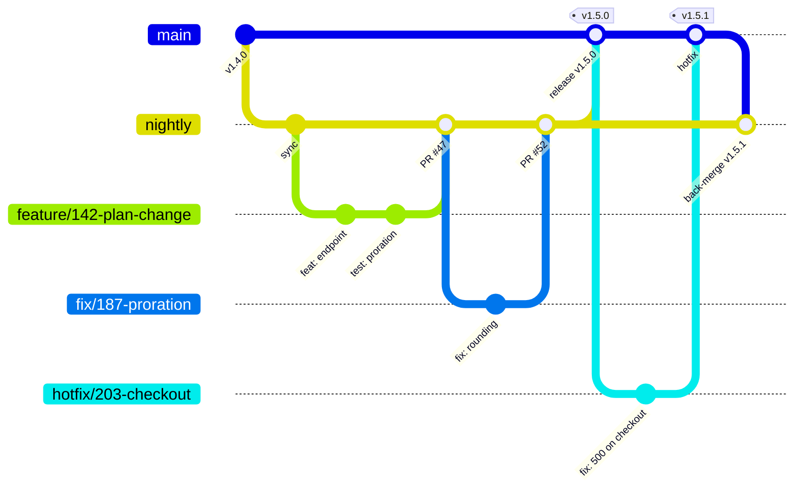

> Part of the [appco SDLC documentation](README.md) - original section 10.

# 10. Branching and Environment Strategy

### 10.1 Comparison of models

| | **GitHub Flow** | **Git Flow** | **Trunk-based** | **Our model: nightly + main** |
|---|---|---|---|---|
| Long-lived branches | `main` | `main`, `develop`, `release/*`, `hotfix/*` | `main` | `main`, `nightly` |
| Feature branches | Short-lived, PR to `main` | Feature → `develop` | Very short (< 1 day) or none | Short-lived, PR to `nightly` |
| Release mechanism | Deploy `main` continuously | Release branch → `main` | Feature flags + continuous deploy | Release PR `nightly` → `main`, tagged |
| Complexity | Low | High | Low, but demands mature practices | Low–medium |
| QA gate before production | None built in | Release branch | Feature flags + progressive rollout | **`nightly` / Preview — built in** |
| Suits our team? | Lacks the tester gate we need | Too many moving parts for our size | Requires strong automated testing we do not have yet | **Yes** |

**Why not plain GitHub Flow:** it deploys `main` continuously, which assumes automated tests are trustworthy enough to replace human validation. We are not there, and we have a tester whose sign-off is a required step.

**Why not Git Flow:** release branches plus `develop` plus hotfix branches produce four long-lived branches, frequent merge conflicts, and a lot of ceremony. Its original context — versioned desktop software with multiple supported versions in the field — is not ours.

**Why not trunk-based:** it is the endpoint we may reach in a year or two, once test coverage and feature flags make human pre-release validation optional for most changes. Adopting it now would mean either shipping unvalidated code or blocking merges on manual testing.

**Why `nightly` + `main` fits:** it is GitHub Flow with exactly one extra branch, and that branch buys us the tester's validation gate. Two long-lived branches, one integration point, one release ritual.

### 10.2 The model

### 10.3 Branch roles

| Branch | Role | Deploys to | Who writes to it | Lifetime |
|---|---|---|---|---|
| **`main`** | **Production.** Always reflects what is live (or about to be). | Production, on tag + approval | Nobody directly. Only release PRs from `nightly` and `hotfix/*` PRs | Permanent |
| **`nightly`** | **Integration + Preview.** The default branch. All feature work lands here first. | Preview, automatically on every merge | Feature/fix PRs, one approval each | Permanent |
| `feature/*`, `fix/*`, `chore/*`, `docs/*`, `refactor/*`, `test/*` | Individual work items | Local + per-PR checks | The author | Hours to days; deleted on merge |
| `hotfix/*` | Emergency production fix | Production, expedited | Branched from **`main`**, PR to `main`, then back-merged to `nightly` | Hours |

**MUST rules:**

1. Feature branches are created **from `nightly`** and merged **into `nightly`**.
2. `main` receives changes **only** via a release PR from `nightly` or a `hotfix/*` PR.
3. Every `hotfix/*` merged to `main` is **back-merged into `nightly` within 24 hours**. Skipping this is how a fix gets silently reverted by the next release — it is the most common failure mode of this branching model.
4. **Never** cherry-pick a subset of `nightly` into `main` to "release just this one thing". If a single change must ship urgently, it is a hotfix branched from `main`. Cherry-picking makes `main` and `nightly` diverge in ways nobody can reason about later.
5. The repository default branch is **`nightly`**, so new PRs target it by default and clones start there.

**Keeping the branches in sync:** immediately after a release PR merges, `main` and `nightly` are identical. After a hotfix, `main` is ahead until the back-merge. **SHOULD:** a scheduled workflow opens a "sync `main` → `nightly`" PR automatically if `main` contains commits absent from `nightly` for more than 24 hours.

### 10.4 Branch protection per branch

| Rule | `main` | `nightly` |
|---|---|---|
| Require a pull request | **Yes** | **Yes** |
| Required approvals | **2** (Tech Lead + PO or second dev) | **1** |
| Restrict who can merge | `@appco/tech-leads`, `@appco/release-approvers` | `@appco/engineering` |
| Restrict source branches | **`nightly` and `hotfix/*` only** (enforced by ruleset or a CI check on the PR base/head pair) | Any `feature/*`, `fix/*`, `chore/*`, `docs/*`, `refactor/*`, `test/*` |
| Required status checks | `validate`, `security` | `validate`, `security` |
| Dismiss stale approvals on new commits | Yes | Yes |
| Require conversation resolution | Yes | Yes |
| Require Code Owner review | Yes | Yes |
| Block force pushes | Yes | Yes |
| Block deletions | Yes | Yes |
| Include administrators | Yes | Yes |
| Require linear history | Yes | Yes |
| Merge method | **Merge commit** (preserves the release's individual commits) | **Squash** (one commit per issue) |

**Note on merge methods:** feature PRs squash into `nightly`, so `nightly` has one clean commit per issue. The release PR then uses a **merge commit** into `main`, preserving those per-issue commits so `main`'s history reads as "everything that shipped", and so generated release notes list each change. Configure the repository to allow both methods and rely on the team to pick correctly — or automate the release PR creation so the method is fixed.

### 10.5 Which branch deploys where

| Event | Branch/ref | Environment | Approval | Workflow |
|---|---|---|---|---|
| PR opened/updated | any → `nightly` or `main` | none (checks only) | — | `pr-validation.yml` |
| Merge | → `nightly` | **Preview** | none | `deploy-preview.yml` |
| Release published from tag | `main` @ `vX.Y.Z` | **Production** | **Required reviewer** | `deploy-production.yml` |
| Manual re-deploy / rollback | `main` @ any prior tag | **Production** | **Required reviewer** | `deploy-production.yml` (`workflow_dispatch`) |
| Hotfix merge + tag | `main` @ `vX.Y.Z+1` | **Production** | **Required reviewer** (expedited, §12.5) | `deploy-production.yml` |

### 10.6 Trade-offs we accept

| Trade-off | Mitigation |
|---|---|
| Two long-lived branches can diverge | Release at least once per sprint; mandatory hotfix back-merge; automated sync PR |
| An extra merge step slows the path to production | Acceptable: the tester gate is the point. Hotfix path exists for genuine urgency |
| `nightly` can be broken by a bad merge, blocking everyone's testing | Required status checks before merge; anyone who breaks `nightly` fixes or reverts it immediately — it is the highest-priority interrupt after a production incident |
| Long-lived feature branches still cause conflicts | Keep branches under ~3 days; rebase on `nightly` daily (§6.3) |
| Testers can be a bottleneck | Testable work is validated continuously as it lands on Preview, not batched at the end of the sprint |

