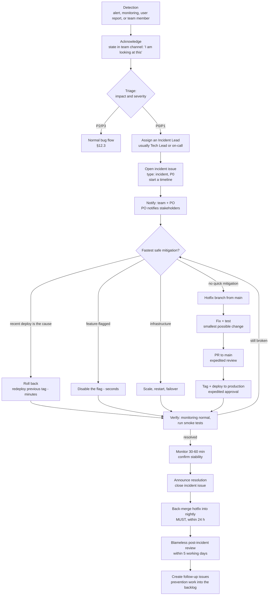

> Part of the [appco SDLC documentation](README.md) - original section 12.

# 12. Bug, Incident, and Hotfix Process

### 12.1 Distinguishing the four categories

| | **Normal bug** | **High-priority bug** | **Production incident** | **Security incident** |
|---|---|---|---|---|
| **Definition** | Defect with a workaround or low impact | Major function broken, no workaround, but the system runs | Production unusable, data at risk, or a critical path down | Vulnerability, breach, or exposed credential |
| **Severity** | `P2`–`P3` | `P1` | `P0`–`P1` | Any — always treated as at least `P1` |
| **Enters** | Backlog, normal prioritisation | Current or next sprint | **Interrupts everything** | **Interrupts everything**, restricted channel |
| **Branch** | `fix/*` from `nightly` | `fix/*` from `nightly` | `hotfix/*` from `main` | `hotfix/*` from `main`, private if needed |
| **Path to production** | Next normal release | Next release, possibly expedited | Direct to `main`, expedited approval | Direct to `main`, expedited approval |
| **Review** | Normal (1 approval) | Normal | Expedited (§12.5) | Expedited + Tech Lead mandatory |
| **Comms** | Issue comments | Issue + team channel | Team channel + stakeholders + status update | Private channel; disclosure per policy |
| **Post-review** | None | None | **Blameless post-incident review required** | **Required** |

### 12.2 Severity levels

| Severity | Criteria | Examples | Response time | Fix target |
|---|---|---|---|---|
| **`P0` Critical** | Production down; data loss or corruption; security breach; payments failing; all users blocked | Site returns 500s; customer data exposed; checkout broken | **Immediately**, any hour | Mitigate < 2 h; fix ASAP |
| **`P1` High** | Major feature broken with no workaround; significant subset of users blocked; committed deadline at risk | Users cannot change their plan; login fails for one auth method | Same working day | Within 1–2 days |
| **`P2` Medium** | Feature impaired but usable; workaround exists; affects some users | Report export missing a column; pagination breaks past page 50 | Within 2 working days | Current or next sprint |
| **`P3` Low** | Cosmetic, rare, or trivial | Misaligned icon; typo; edge case affecting one record | Triage weekly | When convenient |

**Who assigns severity:** whoever files it proposes a severity; **the Technical Lead (or the on-call engineer for out-of-hours) confirms or changes it.** Severity is a technical/impact judgement, not a negotiation — a stakeholder saying "this is critical to me" is priority input, not severity.

**MUST:** disagreement about a `P0` is resolved by treating it as a `P0` and downgrading afterwards. The cost of over-reacting for an hour is far lower than the cost of under-reacting.

### 12.3 Normal bug flow

1. Reporter files a bug using the template (§19.5): steps, expected, actual, environment, evidence.
2. Tech Lead or PO triages within one working day: confirm reproducibility, set severity, set priority, assign an area label.
3. Cannot reproduce → comment asking for specifics; close after 7 days of no response (reopening is free).
4. `P2`/`P3` → backlog, prioritised at refinement like any other work.
5. Fixed on a `fix/*` branch from `nightly`, PR into `nightly`, **with a regression test that fails without the fix** (**MUST**).
6. Deploys to Preview automatically; the reporter or tester verifies there.
7. Ships in the next normal release.

### 12.4 Production incident flow



**Roles during an incident:**

| Role | Who | Does |
|---|---|---|
| **Incident Lead** | Tech Lead or on-call engineer | Owns the response; makes the calls; **does not debug personally** if the incident is large — coordination is a full-time job during an outage |
| **Responders** | 1–2 developers/DevOps | Investigate and fix |
| **Communicator** | PO or Scrum Facilitator | Updates stakeholders every 30 min for `P0`; shields responders from status questions |
| **Scribe** | Anyone available | Maintains the timeline in the incident issue as it happens — reconstructing it afterwards is guesswork |

**Rules:**
- **MUST:** mitigate before diagnosing. Restore service first; understand it afterwards. A rollback that fixes the symptom in 3 minutes beats a root-cause fix that takes 3 hours.
- **MUST:** everything goes in the incident issue as it happens — commands run, what was observed, decisions made and why.
- **MUST NOT** make undocumented manual changes on the production server. If an emergency manual change is unavoidable, it is recorded in the incident issue **and** a follow-up issue is created to codify it, same day.
- **SHOULD:** if the incident lasts more than 2 hours, rotate responders. Tired people cause second incidents.

### 12.5 Emergency hotfix procedure

```bash
# 1. Branch from main — production's exact current state, not nightly
git checkout main && git pull origin main
git checkout -b hotfix/203-checkout-500-error

# 2. Smallest possible fix + a regression test
# 3. Commit and push
git commit -m "fix: handle null payment method in checkout

Refs #203"
git push -u origin hotfix/203-checkout-500-error

# 4. PR into main, labelled 'hotfix'
# 5. Expedited review (below), CI must still pass
# 6. Merge, tag a PATCH version, publish the Release
git checkout main && git pull origin main
git tag -a v1.5.1 -m "Hotfix: checkout 500 error"
git push origin v1.5.1

# 7. Approve the production deployment
# 8. Verify, then back-merge into nightly — MUST
git checkout nightly && git pull origin nightly
git merge main
git push origin nightly
```

**Expedited review rules:**

| Rule | Detail |
|---|---|
| Approvals | **1 approval** instead of 2, from any senior developer or the Tech Lead |
| CI | **MUST still pass.** Never disable checks — a hotfix that breaks something else turns one incident into two |
| Review depth | Focused: "does this fix the problem, and can it break anything else?" Not a style review |
| If no reviewer is available | The Incident Lead **MAY** self-merge, and **MUST** get a retroactive review within 24 hours, recorded on the PR |
| Scope | **MUST** be minimal. No refactoring, no cleanup, no "while I'm here". Improvements go into a follow-up issue |
| Back-merge | **MUST** be completed within 24 hours; the Scrum Facilitator verifies it |

### 12.6 Security incidents

Additional rules on top of §12.4:

1. **MUST NOT** discuss details in public issues or public channels before a fix is deployed.
2. Use a **GitHub private security advisory** for the tracking record (§6.9).
3. Notify the Tech Lead and an org owner immediately; they decide who else needs to know.
4. **Rotate first.** Any exposed credential is revoked and replaced before investigation continues.
5. Preserve evidence — logs, access records — before making changes where feasible.
6. Assess data exposure explicitly: what data, whose, how much, for how long.
7. Legal/regulatory notification obligations are the business's decision; **MUST** be raised to leadership within 24 hours of confirming a breach.
8. Public disclosure only after the fix is deployed, per the `SECURITY.md` policy.

### 12.7 When to interrupt sprint work

| Situation | Interrupt? |
|---|---|
| `P0` production incident | **Yes, immediately.** Everyone who can help stops |
| `P1` bug affecting many users | **Yes**, for one or two people; the rest continue the sprint |
| `P1` bug affecting a few users, workaround exists | No — next sprint, or use the unplanned-work reserve |
| `P2`/`P3` | No |
| "The CEO asked for it" | **No, not directly.** It goes to the PO, who decides against everything else in flight. If it genuinely displaces sprint work, the team is told what is being dropped in exchange |
| `nightly` is broken and blocking the tester | **Yes** — highest priority after a production incident |

**The rule that protects the sprint:** something can only be added to a sprint if something of equal size is removed. This is not obstruction; it makes the trade-off visible instead of hiding it as unpaid overtime and a missed sprint goal.

### 12.8 Blameless post-incident review

**MUST** happen for every `P0` and every `P1` that reached production, within **5 working days**. Timebox: 45–60 minutes. Template: §19.12.

**Blameless means:** we assume everyone acted reasonably given what they knew at the time. If a developer deployed a breaking change, the question is not "why were they careless?" — it is "why did our process let a breaking change through?". People who fear blame hide information, and hidden information causes the next incident.

**Agenda:**
1. **Timeline** (10 min) — what happened, when, factually. No interpretation yet.
2. **Impact** (5 min) — users affected, duration, data impact, revenue/reputation.
3. **Detection** (5 min) — how did we find out? Did monitoring catch it, or did a user? If a user, that is a finding.
4. **Response** (10 min) — what went well, what was slow, what information was missing?
5. **Contributing factors** (15 min) — ask "why" until you reach a systemic cause. There is usually more than one.
6. **Actions** (10 min) — concrete, owned, in the backlog with a target sprint.
7. **Sharing** (5 min) — who else should know what we learned?

**Output (MUST):** a post-incident review document in the product `-docs` repository, and follow-up issues labelled `source: incident` in the backlog.

**Action quality:** prefer changes that make the failure *impossible* or *immediately visible* over changes that ask people to be more careful.

| Weak action | Strong action |
|---|---|
| "Be more careful with migrations" | "Add a CI check that fails a PR containing a `DROP COLUMN`" |
| "Remember to check the queue" | "Alert when queue depth exceeds 1,000 for 5 minutes" |
| "Test better" | "Add an E2E test for the checkout path; it runs on every Preview deploy" |
| "Communicate earlier" | "Incident issue template auto-notifies the PO on `P0`" |

**SHOULD:** review open post-incident actions at every retrospective. Actions that never get done are a message that the incident was not actually considered important — decide honestly and close them if so.

