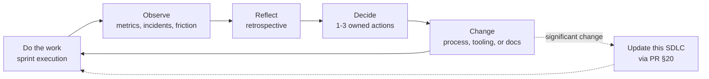

> Part of the [appco SDLC documentation](README.md) - original section 15.

# 15. Metrics and Continuous Improvement

### 15.1 What we measure and why

We measure **the system**, not the people. The purpose of every metric here is to answer "where does work get stuck?" — never "who is slow?".

#### Flow metrics

| Metric | Definition | Why it matters | Healthy direction |
|---|---|---|---|
| **Lead time** | Issue created → deployed to production | The customer's experience of our speed | Decreasing |
| **Cycle time** | `In Progress` → `Done` | The team's execution speed once work starts | Decreasing; < 5 days is a good target |
| **Work item age** | Days an unfinished item has been `In Progress` | **The best early-warning signal there is** — an item aging past 2× the average is stuck now, not at the deadline | Low and stable |
| **PR review time** | PR ready → first review | Review latency is usually the largest hidden delay in a small team | < 1 working day |
| **PR size** | Lines changed per PR | Correlates directly with review quality and defect rate | Decreasing; median < 200 |
| **Blocked duration** | Time in `Blocked` | Measures organisational friction, not developer speed | Low |

#### Delivery metrics (DORA)

| Metric | Definition | Current-typical for a team like ours | Where to aim |
|---|---|---|---|
| **Deployment frequency** | Production deployments per period | Monthly | Weekly, then per-sprint-item |
| **Lead time for changes** | Commit → running in production | Weeks | Days |
| **Change failure rate** | % of deployments causing an incident or rollback | Unknown (unmeasured) | < 15% |
| **Mean time to recovery (MTTR)** | Incident start → resolved | Hours | < 1 hour for `P0` |

These four are the most researched delivery metrics available, and they have a useful property: **they cannot be gamed in isolation.** Deploying more often to look good raises the change failure rate unless quality genuinely improves.

#### Quality metrics

| Metric | Definition | Why |
|---|---|---|
| **Escaped defects** | Bugs found in production per release | Measures how well Preview validation works |
| **Defect origin** | Which phase introduced it (requirements, design, code) | Tells you *where* to improve, not just that you should |
| **Production incident count and severity** | Per month | Reliability trend |
| **Flaky test count** | Tests quarantined | Suite trustworthiness |
| **Time to first response on bugs** | Report → acknowledged | Responsiveness |

#### Process metrics

| Metric | Definition | Caveat |
|---|---|---|
| **Sprint goal completion** | Was the goal achieved? (Yes/Partly/No) | More honest than "% of points completed" |
| **Committed vs. completed** | Items planned vs. finished | For calibrating planning, **never** as a target |
| **Unplanned work %** | Share of sprint capacity spent on unplanned items | Above ~30% consistently means the sprint model is fighting reality — either fix the underlying instability or move to Kanban for that team |
| **Carry-over rate** | Items rolled to the next sprint | High = items too large or capacity over-committed |

### 15.2 What we deliberately do not measure

| Anti-metric | Why it is harmful |
|---|---|
| Lines of code per developer | Rewards verbosity; the best change is often a deletion |
| Commits per developer | Rewards commit-splitting; measures nothing real |
| Individual velocity / story points per person | Points are a *team* forecasting tool. Per-person points destroy collaboration overnight — helping a teammate lowers your number |
| Hours logged | Measures presence, not outcome |
| Test coverage as a hard target | Produces tests written to touch lines, not to catch bugs |
| Bug counts attributed to individuals | Guarantees under-reporting of bugs, which is the opposite of what you want |
| PR count | Rewards fragmentation |

**The governing rule (Goodhart's Law): when a measure becomes a target, it ceases to be a good measure.** Every metric in §15.1 is for *conversation*, not for evaluation. **MUST NOT** use any metric in this section in performance reviews or to compare individuals.

### 15.3 How to use metrics

| Cadence | Metrics | Forum | Purpose |
|---|---|---|---|
| Daily | Work item age, blocked items | Stand-up | Unstick work today |
| Per sprint | Sprint goal completion, carry-over, unplanned work %, PR review time | Retrospective | Improve the process |
| Monthly | DORA four, escaped defects, incident count | Tech Lead review | Spot trends |
| Quarterly | All of the above + technical debt trend | Leadership + team | Strategic decisions, SDLC review (§20) |

**Rules:**
1. **Trends, not absolutes.** "Cycle time fell from 8 to 5 days" is meaningful. "Cycle time is 5 days" is not.
2. **Start with two.** Cycle time and change failure rate. Add more only when the first two are being acted on.
3. **Every metric has an owner** who explains what it means at the review. An unowned dashboard is decoration.
4. **A worsening metric is a question, not a verdict.** Ask what changed before concluding anything.

### 15.4 Where the data comes from

| Metric | Source |
|---|---|
| Lead/cycle time, work item age | GitHub Project field history; the built-in **Insights** charts |
| PR review time, PR size | GitHub PR data / API |
| Deployment frequency, MTTR | GitHub Deployments API + `production` environment history |
| Change failure rate | Deployments vs. rollbacks and incident issues |
| Escaped defects | Issues labelled `source: production` per release |
| Sprint goal completion | Recorded manually at each review — one line per sprint |

GitHub Projects **Insights** gives burn-up, item counts by field, and historical status over time out of the box. **SHOULD** start there rather than building anything custom; a custom metrics dashboard is a project of its own and rarely repays the effort at our size.

### 15.5 The improvement loop

*The loop only works if step D produces small numbers. Three actions completed beats fifteen actions listed.*

