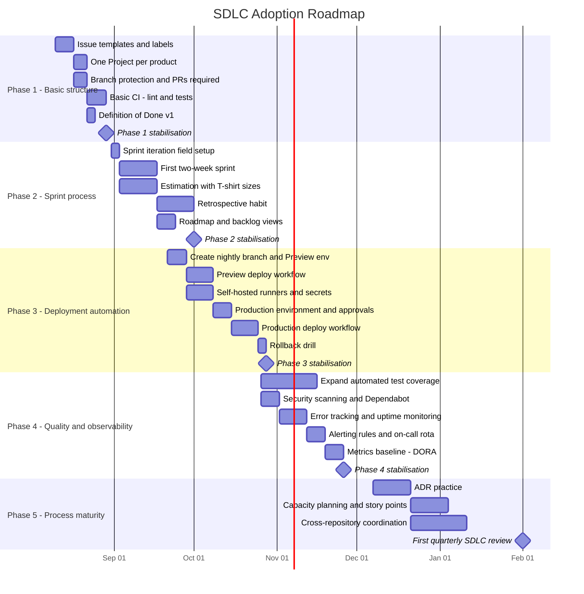

> Part of the [appco SDLC documentation](README.md) - original section 16.

# 16. Gradual Adoption Plan

### 16.1 How to use this plan

Five phases over roughly six months. **A phase is complete when its practices are habit, not homework** — when people do them without being reminded. Moving to the next phase before that produces a team going through motions it does not believe in.

Timings below are indicative. The readiness indicators are the real gate.

### 16.2 Phase 1 — Basic structure (weeks 1–3)

**Goal:** every piece of work is visible, and no code reaches a shared branch unreviewed.

| Required change | Detail |
|---|---|
| Issue templates | Feature request, bug report, technical task in the org `.github` repo |
| Label scheme | `type:*`, `priority:*`, `area:*` applied consistently |
| One GitHub Project per product | Auto-add new issues; six statuses only (§7.3) |
| **Everything becomes an issue** | Including work already in progress. This is the hard part |
| Branch protection | `main`: PR required, 1 approval, no force push, no deletion |
| Branch naming + Conventional Commits | Documented in each README |
| Basic CI | Lint + tests on PR, as a required check |
| PR template | Short version: what, why, how tested, linked issue |
| Definition of Done v1 | Six items (§11.2), pinned as an issue |

**Expected benefits:** the team can see all work in one place; nothing gets silently lost; code review starts spreading knowledge; broken code stops reaching shared branches.

**Risks and mitigations:**

| Risk | Mitigation |
|---|---|
| "This slows me down" | True at first, and worth saying out loud. Timebox: try it for three weeks, then discuss honestly at a retrospective |
| Issues created but never updated | Automate what can be automated; the Facilitator nudges daily for the first two weeks |
| PR reviews become a bottleneck | Set the 1-working-day expectation and the review-before-new-work rule from day one |
| CI is slow or flaky, so people ignore it | Keep it under 10 minutes; fix flakes immediately — trust is lost fast and regained slowly |

**Ready for Phase 2 when:** ~90% of work has an issue; no direct pushes to `main` for two consecutive weeks; PRs are reviewed within a day on average; the board is accurate without prompting.

### 16.3 Phase 2 — Sprint process (weeks 4–10)

**Goal:** a predictable delivery rhythm and the beginnings of forecasting.

| Required change | Detail |
|---|---|
| Sprint iteration field | Two-week iterations, configured 6 ahead |
| Sprint planning | 1–2 h at sprint start; agree a Sprint Goal |
| Daily stand-up | 10–15 min, same time |
| Sprint review | 45 min demo of the deployed increment |
| Retrospective | 45 min; 1–3 owned actions |
| Backlog refinement | 45–60 min mid-sprint |
| Estimation | T-shirt sizes; Planning Poker; 2 min/item |
| Definition of Ready | Introduced and enforced at planning |
| Views | Backlog, Current Sprint, My Work, Blocked |
| Issue template improvement | Add acceptance criteria fields based on what has been missing |

**Expected benefits:** stakeholders get a demo every two weeks; the team learns to break work down; problems surface within a day; the process starts improving itself.

**Risks and mitigations:**

| Risk | Mitigation |
|---|---|
| Ceremonies become theatre | Timebox strictly; cancel any meeting with no decision or output; ask "should we delete this?" at every retro |
| Sprint commitments consistently missed | Plan to ~60% of raw capacity for the first 3 sprints; treat the miss as data, not failure |
| Estimation becomes an argument | Timebox to 2 min; take the higher number; move on |
| Retrospective actions never happen | Review the previous retro's actions **first**, every time |
| Stakeholders keep interrupting mid-sprint | Route everything through the PO; make the trade-off explicit ("yes, and we drop X") |

**Ready for Phase 3 when:** three consecutive sprints have completed their goal at least partly; retro actions are actually being done; estimates are within roughly ±30% at the sprint level; stand-ups run under 15 minutes without policing.

### 16.4 Phase 3 — Deployment automation (weeks 8–16)

**Goal:** deployments become boring: automatic to Preview, one approved click to production.

| Required change | Detail |
|---|---|
| Create `nightly` in every repo; make it the default branch | §10.3 |
| Protect `main` and `nightly` differently | §10.4 |
| Provision the Preview environment | Server, database, config mirroring production |
| GitHub Environments | `preview` (no approval) and `production` (required reviewers, tag-restricted) |
| Move deployment secrets to Environment secrets | §6.5 |
| Self-hosted runners | One per environment, separate groups and labels (§9) |
| `deploy-preview.yml` | Automatic on merge to `nightly` |
| `deploy-production.yml` | On Release published, approval-gated, with health checks and auto-rollback |
| Release PR ritual | `nightly` → `main`, tag, GitHub Release, generated notes |
| Rollback procedure documented **and drilled** | A rollback nobody has practised is a hope, not a procedure |
| Migration policy | Expand/contract; backup verification before production |

**Expected benefits:** deploy time drops from hours to minutes; the tester gets a stable environment; production releases stop being events people dread; rollback is possible.

**Risks and mitigations:**

| Risk | Mitigation |
|---|---|
| Deployment scripts break production while being built | Build and prove the Preview pipeline completely first; production reuses the same, proven mechanism |
| Self-hosted runner misconfigured → security exposure | Follow §9.4 exactly; deploy jobs never trigger on `pull_request`; private repos only |
| Secrets leak into logs | Environment secrets; secret scanning + push protection; never echo values |
| Nobody knows how to roll back under pressure | **Run a deliberate rollback drill on Preview, then on production, before you need one** |
| `nightly` and `main` diverge | Release every sprint; mandatory hotfix back-merge; automated sync PR |

**Ready for Phase 4 when:** ten consecutive Preview deploys succeeded unattended; at least three production releases have gone through the approval flow; one rollback has been performed successfully on purpose; nobody deploys by hand any more.

### 16.5 Phase 4 — Quality and observability (weeks 12–22)

**Goal:** we detect problems before users do, and the test suite is trusted.

| Required change | Detail |
|---|---|
| Expand automated tests | Integration tests for every endpoint; E2E for critical journeys |
| Test quality standard | Bug fixes ship with a regression test (**MUST**) |
| Flaky test policy | Quarantine after two flakes; fix within a sprint |
| Security scanning | Dependabot, CodeQL, secret scanning with push protection |
| Error tracking | Sentry (or equivalent) in Preview and Production |
| Uptime + health monitoring | External checks on both environments |
| Server, database, queue, cron monitoring | §13.2 |
| Alerting | Severity-routed; tested quarterly |
| Metrics baseline | DORA four + cycle time; reviewed monthly |
| Weekly production review | 20 min; findings become issues |

**Expected benefits:** fewer escaped defects; faster incident detection and recovery; evidence-based process discussions instead of opinion-based ones.

**Risks and mitigations:**

| Risk | Mitigation |
|---|---|
| Alert fatigue | Alert only on symptoms that need human action; delete noisy alerts immediately |
| Test suite becomes slow | Keep PR checks < 10 min; move slow suites to post-merge and nightly |
| Metrics used to judge people | State the rule explicitly and repeatedly (§15.2); leadership must model it |
| Testing effort competes with features | Budget it (10–20% of the sprint) and defend it with escaped-defect data |

**Ready for Phase 5 when:** most production issues are detected by monitoring rather than users; the team trusts the test suite enough to release on it; DORA metrics have three months of history; alert noise is low enough that alerts are read.

### 16.6 Phase 5 — Process maturity (from ~week 20, ongoing)

**Goal:** the process improves itself and scales past one team.

| Required change | Detail |
|---|---|
| ADR practice | Write ADRs for significant decisions; review them as PRs |
| Story points + velocity | Move from T-shirts; use velocity for capacity forecasting only |
| Capacity planning | Account for leave, support duty, and the unplanned-work reserve explicitly |
| Cross-repository coordination | Dependency tracking; deployment ordering; shared release coordination |
| Full DoD | All 15 items (§11.2) |
| Full status set | Expand from 6 statuses if the team needs the granularity |
| Onboarding path | New joiner productive in a week; first PR on day one |
| Quarterly SDLC review | §20 |
| Consider a Staging environment or trunk-based development | Only if the constraints that made them unnecessary have changed |

**Expected benefits:** decisions are remembered; planning is credible; the team can grow or split without losing consistency.

**Risks and mitigations:**

| Risk | Mitigation |
|---|---|
| Process ossifies into bureaucracy | Every quarterly review asks what to **delete**, not only what to add |
| ADRs written for everything | Reserve for expensive-to-reverse decisions (§14.4) |
| Metrics become targets | Enforce §15.2 |
| Documentation drifts | Quarterly sweep; docs updated in the same PR as the change |

**Indicators of maturity:** the team changes the process themselves via PRs to this document; new joiners follow it without much explanation; the process survives a stressful release without anyone bypassing it.

### 16.7 Adoption at a glance

| | Phase 1 | Phase 2 | Phase 3 | Phase 4 | Phase 5 |
|---|---|---|---|---|---|
| **Focus** | Visibility | Rhythm | Automation | Confidence | Maturity |
| **Duration** | 3 weeks | 6 weeks | 8 weeks | 10 weeks | Ongoing |
| **Biggest habit change** | Everything is an issue | Fixed ceremonies | No manual deploys | Monitoring before users | Written decisions |
| **Main risk** | Feels like overhead | Ceremony theatre | Security misconfiguration | Alert fatigue | Bureaucracy |
| **Success signal** | Board matches reality | Goals met, retros act | Boring deploys | Problems found first by us | Team edits the process |

