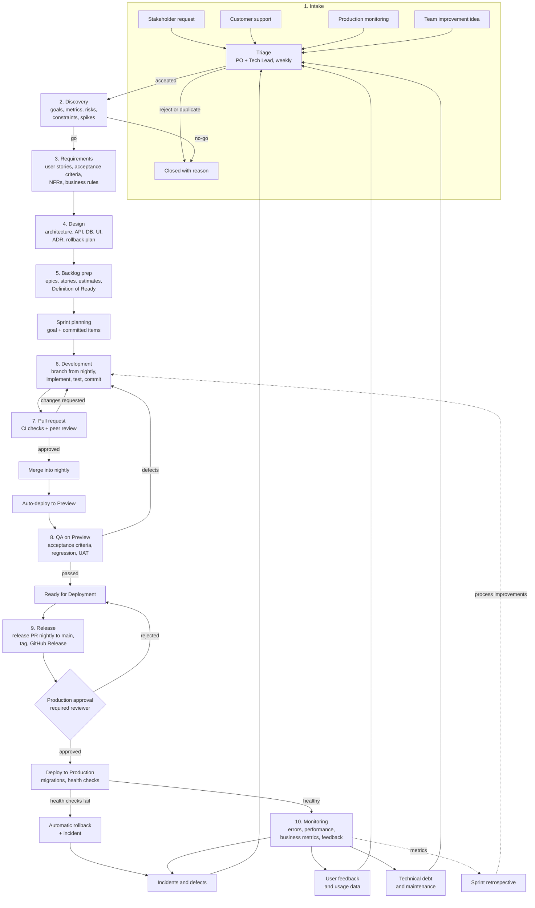
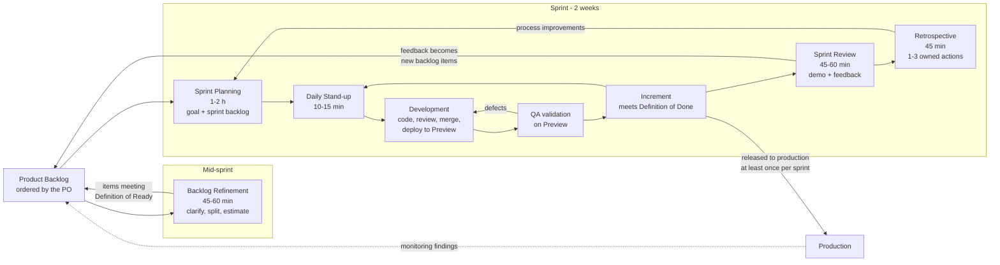
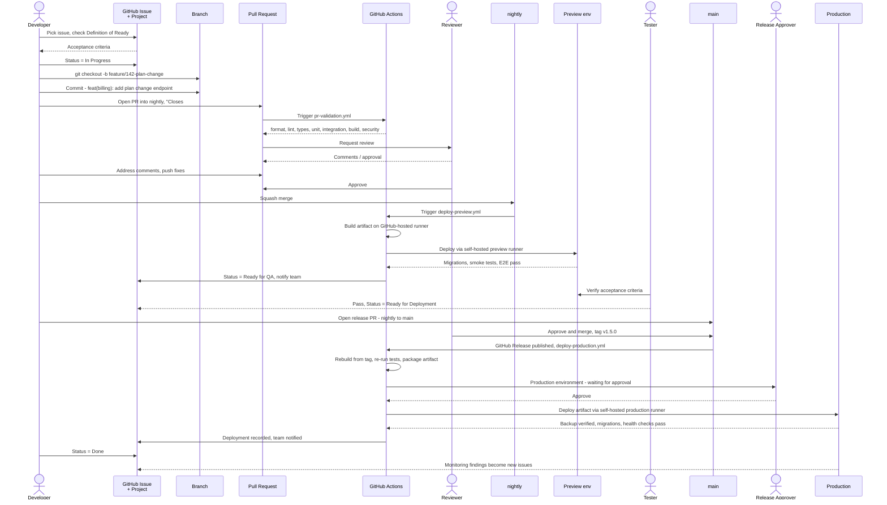
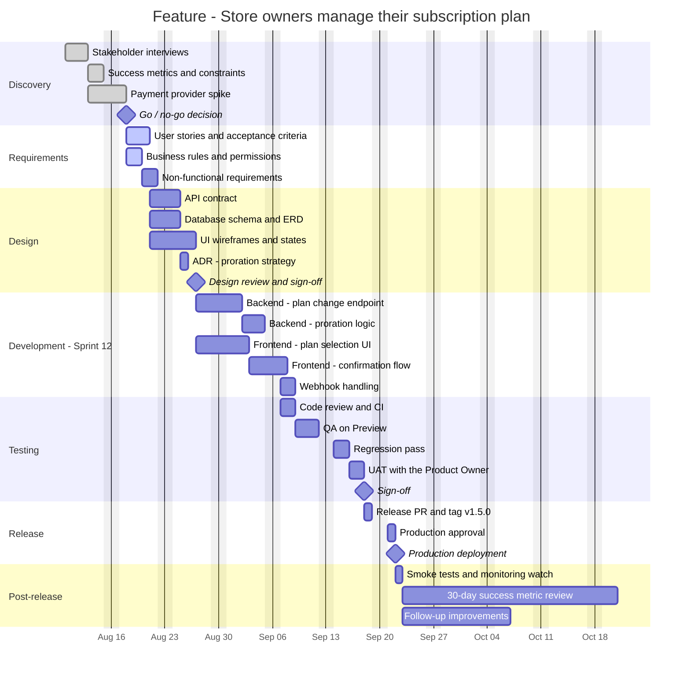

> Part of the [appco SDLC documentation](README.md) - original section 17.

# 17. Diagram Reference

Every diagram in this document is Mermaid, so it lives in version control, renders on GitHub, and can be reviewed in a pull request like code (§14.3).

### 17.1 Index

| # | Diagram | Location |
|---|---|---|
| **A** | Complete SDLC flowchart | §17.2 (phase summary also in §5.0) |
| **B** | Agile Scrum sprint cycle | §17.3 |
| **C** | GitHub Issue-to-Production workflow | §17.4 (compact version in §1.3) |
| **D** | GitHub Organization and repository structure | [§6.13](#613-how-multiple-repositories-connect-to-one-project) |
| **E** | CI/CD pipeline | [§8.2](#82-pipeline-overview) |
| **F** | GitHub Project status flow | [§7.4](#74-status-flow-and-wip-limits) |
| **G** | Environment promotion | [§9.2 of Phase 9](#92-environment-promotion) |
| **H** | Incident and hotfix workflow | [§12.4](#124-production-incident-flow) |
| **I** | Responsibility / communication flow | [§4.4](#44-communication-flow) |
| **J** | Example roadmap / Gantt | §17.5 (adoption roadmap Gantt in §16.1) |
| — | Work breakdown hierarchy | §5 Phase 5.1 |
| — | Hybrid Scrum-Kanban intake | §3.4 |
| — | Testing pyramid | §5 Phase 8.1 |
| — | Triage decision flow | §5 Phase 1.3 |
| — | QA verification loop | §5 Phase 8.5 |
| — | Release process | §5 Phase 9.3 |
| — | Runner and network architecture | §9.5 |
| — | Branching model (gitGraph) | §10.2 |
| — | Improvement loop | §15.5 |

### 17.2 Diagram A — Complete SDLC flowchart

*The whole lifecycle, with its two feedback loops made explicit: **product** feedback (monitoring → intake) and **process** feedback (metrics → retrospective → how we work). A lifecycle without both is a one-way pipeline, and one-way pipelines never get better.*

### 17.3 Diagram B — Agile Scrum sprint cycle

*Refinement sits deliberately outside the sprint box: it prepares the work for the *next* sprint, which is why planning can be selection rather than discovery. Note the two arrows returning to the backlog — review feedback and monitoring findings — and the one returning to planning: retrospective actions.*

### 17.4 Diagram C — GitHub Issue to Production

*Read this as the answer to "what actually happens to my work?". Every handoff is a GitHub artefact — no step depends on someone remembering to tell someone else.*

### 17.5 Diagram J — Example feature roadmap (Gantt)

Sample: the "subscription plan management" feature from §18.

*Useful for communicating shape and sequence to stakeholders. **Read it with §7.6 in mind:** dates beyond the current sprint are forecasts, not commitments, and the discovery/requirements/design bars will move as the team learns. Update the chart when reality changes rather than defending it — a Gantt chart that is never updated is a work of fiction that people plan around.*

