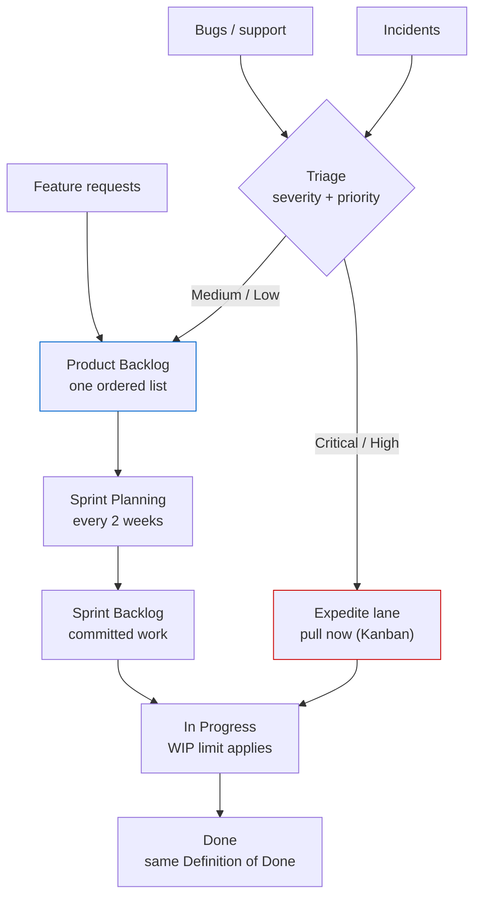
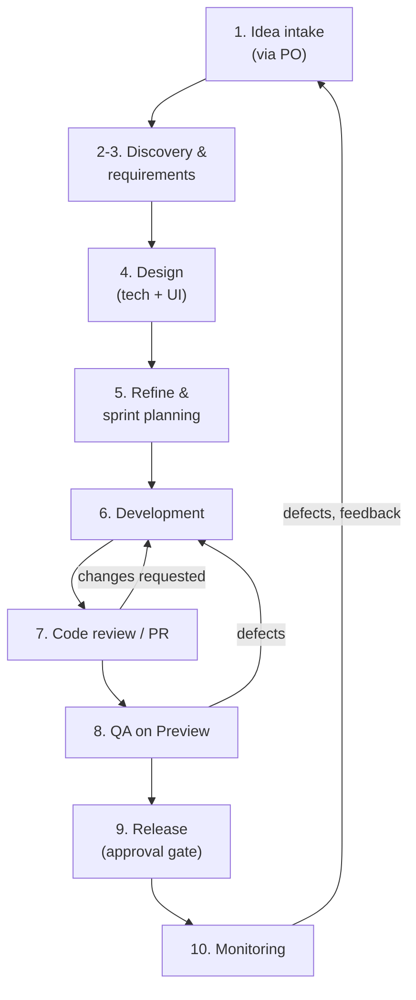
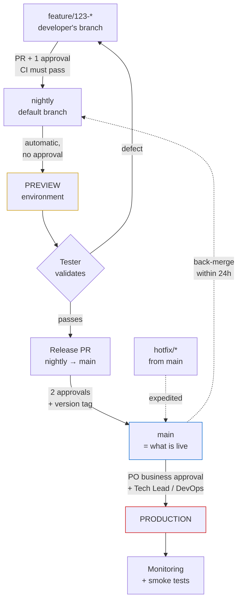
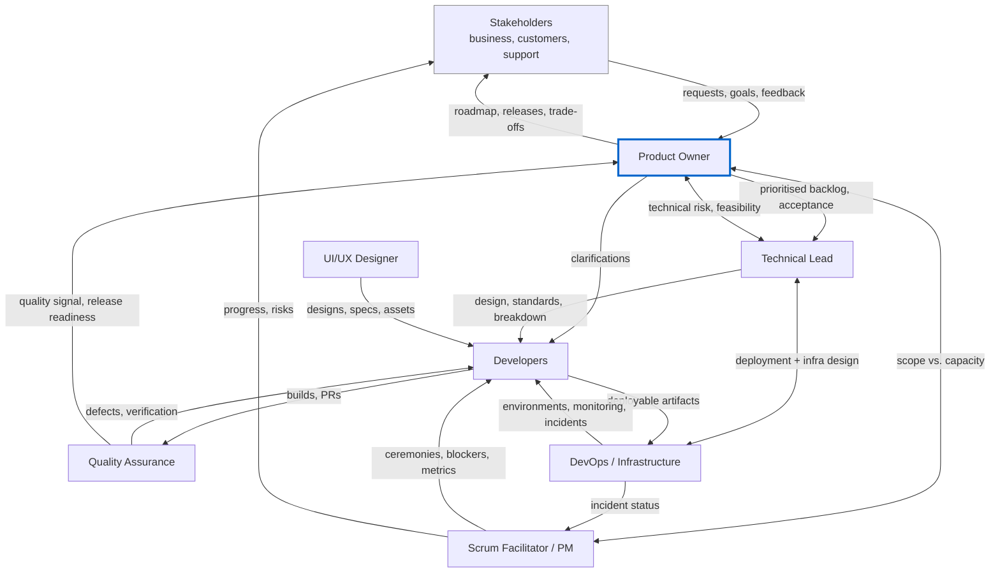
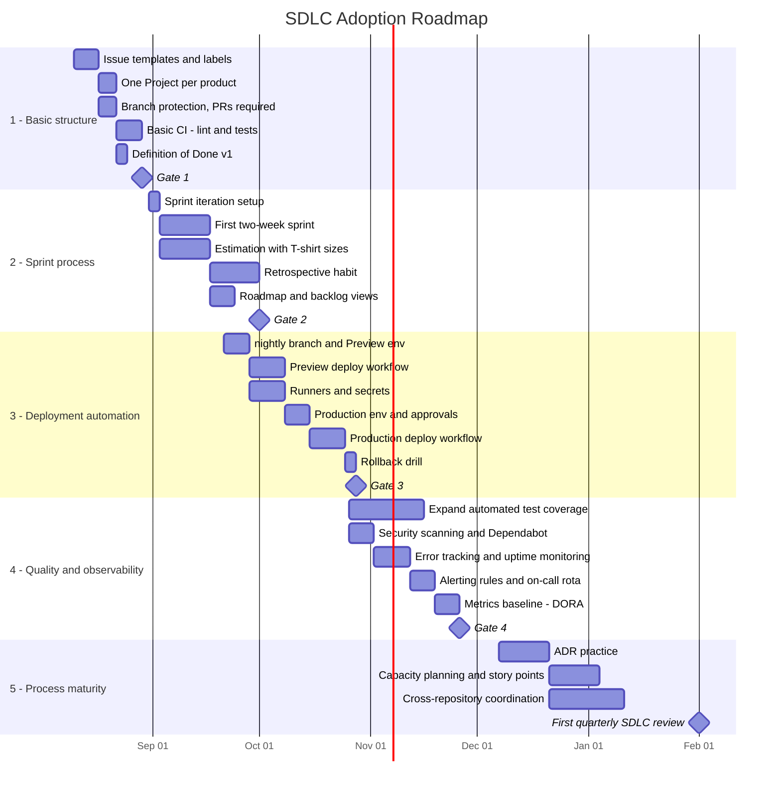
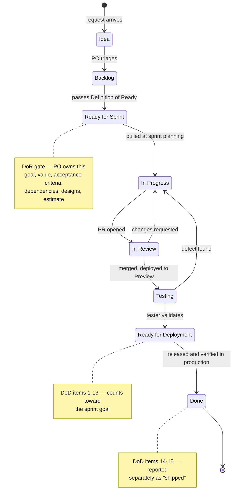

# appco SDLC — Executive Brief

_Summary of the full SDLC documentation (`/SDLC`). For the Product Owner._

---

## 1. What this is and why

A written development lifecycle for appco, built on **GitHub as the single platform** (Issues, Projects, PRs, Actions, Environments, Releases).

The problem it solves: today the process lives in people's heads. That works with 2 developers and 1 product; it breaks with several products, several repos each, and new joiners. The document replaces "ask whoever remembers" with a path every request follows.

**Methodology:** Scrum for planned work (2-week sprints) + Kanban for unplanned work (bugs, incidents), on **one board**. 15–25% of each sprint's capacity is reserved for unplanned work up front, instead of pretending it doesn't exist and missing the sprint goal.

_Both lanes end at the same "Done". The only difference is how work is selected: sprint items at planning, expedite items immediately when triage says Critical or High. **No parallel boards** — two boards means two places to look and one is always stale._

---

## 2. Life cycle flow

Phases 1–5 happen outside the sprint. Phases 6–9 are the sprint loop. Phase 10 runs continuously and feeds back into intake.

**Traceability** — every step is a link GitHub creates for free once conventions are followed:
`Issue → Project item → branch → commits → PR → CI → merge to nightly → Preview → release tag → Production`.
From a production error we can reach the original business request without a spreadsheet.

**Process is sized to the change** — not everything gets the full treatment:

| Size                                 | What it needs                                        |
| ------------------------------------ | ---------------------------------------------------- |
| Trivial (copy, config, version bump) | Issue only                                           |
| Small (< 2 days, 1 repo)             | Issue + acceptance criteria                          |
| Medium (< 1 sprint)                  | + short technical note, design if UI                 |
| Large / Epic (multi-sprint)          | Full phases 1–4: brief, ADR, diagrams, rollback plan |

_Exception: anything touching the database schema, auth, money, or data retention takes the Medium path minimum, however small the code._

### How a change reaches production

Two long-lived branches, one release ritual. The extra branch (`nightly`) exists to buy the tester's validation gate — nothing reaches `main` that hasn't passed on Preview. **The only human approvals in the whole path are code review and the production release decision**; everything else is automated.

---

## 3. Roles and responsibilities

Roles are **hats, not people** — one person can wear several, and that is expected at our size. The failure mode we're avoiding is not "too few people", it's "everyone assumed someone else was doing it". For every activity, exactly one person knows they are accountable.

| Team size      | Typical assignment                                                                                                                                                      |
| -------------- | ----------------------------------------------------------------------------------------------------------------------------------------------------------------------- |
| **3–4 people** | Tech Lead also acts as DevOps and Scrum Facilitator; PO is a founder or account manager; developers do their own QA with a cross-check rule (nobody QAs their own work) |
| **5–8 people** | Dedicated PO; Tech Lead separate from Facilitator (can be a rotating developer); one developer owns DevOps ~20% of their time; one part-time QA                         |
| **8+ people**  | Split into two teams per product; dedicated QA and DevOps                                                                                                               |

**Three rules that hold at any team size:**

1. Nobody approves their own PR when another qualified reviewer exists.
2. Nobody is the only person who can deploy to production — at least two hold access and know the procedure.
3. The person who wrote a feature is not the only person who tests it.

### The eight roles

#### Product Owner — _owns what we build and in what order; accountable for value_

- **Backlog ownership** — maintains a single, ordered product backlog in the GitHub Project
- **Prioritisation** — decides relative priority; tie-breaker when stakeholders disagree
- **Requirements** — writes or approves user stories, business rules, acceptance criteria
- **Acceptance** — accepts or rejects completed work against acceptance criteria
- **Stakeholder interface** — single point of contact for business requests; shields the team from direct channel requests
- **Availability** — **MUST** be reachable within one working day for clarifications during a sprint
- **Release scope** — decides what goes into a release; gives business approval for production deployment
- **Does not:** assign tasks to individuals, estimate on the team's behalf, or change scope mid-sprint without agreement

#### Project Manager / Scrum Facilitator — _owns that the process runs and obstacles get removed; accountable for flow, not content_

- **Ceremonies** — schedules and facilitates planning, stand-up, review, retrospective
- **Board hygiene** — ensures the Project board reflects reality; chases stale items
- **Impediments** — tracks blockers to resolution; escalates when needed
- **Process coaching** — teaches the process to new members; guards against both erosion and bloat
- **Reporting** — produces sprint and roadmap views for stakeholders
- **Metrics** — maintains the metrics and brings them to retrospectives
- **Risk & dependency tracking** — maintains cross-repository and cross-team dependencies
- **Does not:** decide technical approach, decide priority, or assign work to individuals (the team pulls)

#### Technical Lead — _owns technical coherence and quality; accountable for the architecture holding together_

- **Architecture** — approves significant technical designs; owns Architecture Decision Records
- **Standards** — defines and maintains coding standards, branching rules, review standards
- **Technical breakdown** — converts features into technical tasks; identifies technical risk and spikes
- **Review** — final reviewer for high-risk changes (security, data model, integrations, migrations)
- **Estimation support** — facilitates estimation; challenges unrealistic estimates in _both_ directions
- **Mentoring** — grows the team's capability; pairs on hard problems
- **Technical debt** — maintains the tech-debt register and argues for its budget each sprint
- **CODEOWNERS** — maintains the ownership mapping per repository

#### Developers — _own the implementation and its quality; accountable for what they merge_

- **Implementation** — build features and fixes against acceptance criteria
- **Tests** — write and maintain automated tests for their changes (**MUST** for new logic)
- **Self-review** — review their own diff before requesting review
- **Peer review** — review teammates' PRs; **review takes priority over starting new work**
- **Board updates** — keep issue status current; raise blockers same-day
- **Estimation** — estimate their own work honestly, including uncertainty
- **Documentation** — update README, API docs, and runbooks affected by their change
- **Deployment verification** — confirm their change works in the target environment after deploy

#### UI/UX Designer

- **Research** — user flows, problem framing, usability input during discovery
- **Design** — wireframes, mockups, prototypes, interaction states and empty/error states
- **Design system** — maintains shared components and design tokens; coordinates the `shared-ui` repository
- **Handover** — provides specs, assets and states _before_ development starts (a Definition of Ready item for UI work)
- **Review** — reviews implemented UI against the design; approves visual PRs
- **Accessibility** — ensures contrast, keyboard navigation and semantic structure are specified

#### Quality Assurance

- **Test strategy** — defines what is tested where
- **Test cases** — derives test cases from acceptance criteria
- **Exploratory testing** — finds what scripted tests cannot
- **Regression** — maintains and runs the regression suite before releases
- **Bug reporting** — files reproducible, well-documented bugs
- **Release verification** — runs the Preview test pass and post-deployment smoke tests
- **Automation** — grows automated end-to-end coverage over time
- _If there is no dedicated QA:_ the Definition of Done requires that a **different** team member than the author verifies acceptance criteria on Preview before an item is Done

#### DevOps / Infrastructure Owner

- **CI/CD** — builds and maintains GitHub Actions workflows and reusable workflows
- **Environments** — provisions and maintains dev/Preview/Production; configures GitHub Environments and protection rules
- **Secrets** — owns secret storage, scoping and rotation
- **Runners** — manages self-hosted runners, labels, groups and isolation
- **Monitoring** — sets up health checks, error tracking, alerting, log collection
- **Backups** — ensures backups exist **and are periodically restore-tested**
- **Deployment execution** — owns the deployment mechanism; performs or supervises production releases
- **Incident support** — first responder for infrastructure incidents

#### Stakeholders

- **Provide context** — business goals, constraints, deadlines, regulatory needs
- **Submit requests** — through the defined intake path, **not** by direct message to a developer
- **Participate** — attend sprint reviews; give feedback on the increment
- **Decide** — business trade-offs when the PO escalates
- **Accept** — formal sign-off for major releases where required

### What this means for you as Product Owner

**One hard commitment:** reachable within **one working day** for clarifications during a sprint. That single availability guarantee is what makes the rest of the process work — a blocked question costs a whole sprint item.

**Three things only you can make real:** the ordered backlog (one list, not several conversations), acceptance criteria written before work starts, and the single intake path that keeps business requests off developers' direct messages.

**Decision rights on the big calls (from the RACI):**

| Decision                          | Accountable       | Responsible                              |
| --------------------------------- | ----------------- | ---------------------------------------- |
| Business priority / backlog order | **PO**            | PO                                       |
| Requirement definition & approval | **PO**            | PO                                       |
| Release scope                     | **PO**            | PO                                       |
| Production deployment approval    | **PO** (business) | Tech Lead + DevOps (technical readiness) |
| Technical design & architecture   | Tech Lead         | Tech Lead + devs                         |
| Task estimation                   | Tech Lead         | Developers                               |
| Technical debt prioritisation     | **PO**            | Tech Lead                                |

_Production release is the clearest split: you're accountable for the business decision to ship; Tech Lead and DevOps are responsible for judging technical readiness and executing. GitHub enforces it with a required approval on the `production` environment._

### How information flows between roles

**Two rules make this diagram real:** (1) business requests enter through the Product Owner, not by direct message to a developer; (2) the Scrum Facilitator communicates progress outward, so developers are not interrupted for status.

---

## 4. The plan to adopt

Five phases over roughly six months. **A phase is not started until the previous one is habit, not homework.** Timings are indicative; the readiness signals are the real gate.

_Phases overlap deliberately — automation work (Phase 3) can start while the sprint habit (Phase 2) is still settling, because different people do it._

| Phase                          | Timing         | Focus      | Headline change                                                                                                         | Ready for next when                                                                                                                |
| ------------------------------ | -------------- | ---------- | ----------------------------------------------------------------------------------------------------------------------- | ---------------------------------------------------------------------------------------------------------------------------------- |
| **1. Basic structure**         | Weeks 1–3      | Visibility | Everything becomes an issue; one Project per product; PRs required on `main`; basic CI; Definition of Done v1 (6 items) | ~90% of work has an issue; no direct pushes to `main` for 2 weeks; PRs reviewed within a day; board accurate without prompting     |
| **2. Sprint process**          | Weeks 4–10     | Rhythm     | Two-week sprints; planning / stand-up / review / retro; T-shirt estimates; Definition of Ready                          | 3 consecutive sprints partly meeting their goal; retro actions actually done; estimates within ±30%; stand-ups under 15 min        |
| **3. Deployment automation**   | Weeks 8–16     | Automation | `nightly` → Preview auto-deploy; protected environments; `main` → Production with approval gate; **rollback drilled**   | 10 unattended Preview deploys; 3 production releases through the approval flow; 1 deliberate rollback performed; no manual deploys |
| **4. Quality & observability** | Weeks 12–22    | Confidence | Test coverage expansion; security scanning; error tracking, uptime monitoring, alerting; DORA metrics baseline          | Most production issues found by monitoring, not users; team trusts the test suite; 3 months of metrics history                     |
| **5. Process maturity**        | Week 20 onward | Maturity   | ADRs; story points and capacity planning; cross-repo coordination; full 15-item DoD; quarterly SDLC review              | Team edits the process themselves; process survives a stressful release without being bypassed                                     |

**Main risk per phase:** 1 — feels like overhead · 2 — ceremony theatre · 3 — security misconfiguration · 4 — alert fatigue · 5 — bureaucracy. Each is named in the full document with a mitigation.

**First 3 weeks, concretely:** issue templates and labels, one GitHub Project per product, branch protection on `main`, lint+test CI on PRs, PR template, and a pinned 6-item Definition of Done. Nothing else.

---

## 5. Other things worth noting

**What it costs.** Roughly **5.5–6.5 hours of meetings per developer per two-week sprint — about 7% of working time.** Plus 5–15 min to write an issue properly and 5 min for a PR description. The document sets its own tripwire: **if meetings exceed ~10% of a sprint, we're doing it wrong** and the retrospective cuts something.

**"Done" gets a written definition.** Currently the most expensive ambiguity we have. Two stages: an item is `Ready for Deployment` when built, reviewed, tested and validated on Preview; it is `Done` only once it's in production and verified. Sprint completion counts the first; "shipped" reports the second. Starts at 6 checkboxes, grows to 15 as practices become real.

**"Ready" gets one too.** An item without clear goal, business value, testable acceptance criteria, and an estimate is **not pulled into a sprint** — not "pulled in and clarified later". That is the single biggest protection against mid-sprint surprises, and it depends on PO input. (P0 incidents are exempt — nobody writes acceptance criteria while production is down.)

_The two-stage Done matters for reporting: because releases are periodic, an item can be genuinely complete for a week before it ships. Sprint completion counts `Ready for Deployment`; "shipped" is reported separately._

**Deployments become boring.** Automatic to Preview on every merge; one approved click to Production. Rollback is documented **and drilled before it's needed** — a rollback nobody has practised is a hope, not a procedure.

**Metrics measure the system, not people.** Cycle time, PR review time, escaped defects, and the DORA four (deploy frequency, lead time, change failure rate, recovery time). Explicitly not for individual performance review — the document says so repeatedly, and leadership modelling that is what makes it true.

**The process is versioned like code.** It lives in a repo, changes by pull request, and is reviewed quarterly in the first year. Every review asks **"what can we delete?"**, not only what to add. Exceptions to the rules are fine — undocumented exceptions are not, because they're indistinguishable from the process quietly eroding. A rule bypassed repeatedly is treated as a bad rule, not a discipline problem.

**Deliberately deferred:** a separate Staging environment, trunk-based development, story points, and full Scrum ceremony. Each is a Phase 5 "only if we actually need it" item.

---

## 6. What we'd need from you

1. **Agree to the Phase 1 scope and a start date** — 3 weeks, low cost, no ceremony changes yet.
2. **Confirm you'll take the PO role as defined above**, including the one-working-day response commitment during sprints.
3. **Back the single intake path** — business requests route to you, not directly to developers. This only works if it's enforced from the top.
4. **Name the other hats:** who is Tech Lead, who facilitates, who owns DevOps. One person can hold several; what matters is that it's named.
5. **Accept ~7% of team time as process overhead**, with the 10% tripwire as the check that it stays honest.

> The measure of success is not compliance with the document. It is that work is visible, changes are reviewed, releases are boring, and problems are found by us before our users find them.
