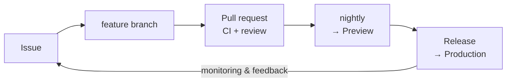

# APPCO PTE. LTD.

**We design, build, and run software products — web, mobile, and the services behind them.**

<!--
  Replace the line above (and the "What we build" table) with the real product list
  once it is public: what we sell, and who uses it.
-->

This organization is our engineering home. Every product we ship is planned, reviewed,
tested, and released here — in the open across our repositories, on one platform.

---

## What we build

| | |
|---|---|
| **Products** | Customer-facing web and mobile applications, and the APIs that serve them |
| **Shared code** | An internal design system and shared libraries used across every product |
| **Platform** | Infrastructure as code, reusable CI/CD workflows, and deployment automation |

## How we work

We run a documented software development lifecycle rather than tribal knowledge. The short version:

| | |
|---|---|
| **Planning** | Scrum for planned work on two-week sprints, Kanban for bugs and incidents — one board, one backlog |
| **Everything is an issue** | Requests, bugs, and technical work all enter through GitHub Issues. No work is invisible |
| **Every change is reviewed** | No code reaches a shared branch without a pull request, passing CI, and a second pair of eyes |
| **Two environments** | `nightly` deploys to Preview automatically, where it is validated; `main` deploys to Production behind an approval gate |
| **Small and reversible** | We prefer many small releases with a known rollback path over large, risky ones |
| **Traceable** | Every line in production traces back through its release, pull request, issue, and the business need that asked for it |

## Finding your way around

Repositories are named `<product>-<component>`, lowercase and hyphenated, so a product's
repositories group together alphabetically:

| Pattern | Contains |
|---|---|
| `<product>-frontend` / `-backend` / `-mobile` | The applications that make up a product |
| `<product>-docs` | Product briefs, requirements, and cross-repository decisions |
| `shared-*` | Design system, shared libraries, and reusable GitHub Actions workflows |
| `infrastructure` | Environment definitions, server configuration, and runner setup |
| `.github` | This profile, plus organization-wide issue and pull request templates |

## Security

Please **do not** report security vulnerabilities as public issues. Open a private security
advisory on the affected repository, or write to us at the address in our
[security policy](https://github.com/APPCO-PTE-LTD/.github/blob/main/SECURITY.md). We will
acknowledge your report and keep you updated through to resolution.

## Get in touch

- **Questions and ideas** — [organization discussions](https://github.com/orgs/APPCO-PTE-LTD/discussions)
- **Business enquiries** — <!-- add the company contact address -->
- **Working with us** — we hire people who like small pull requests, honest estimates, and boring releases

<!--
  This file is the PUBLIC organization profile shown at https://github.com/APPCO-PTE-LTD.
  Keep it short and current. Internal guidance for members belongs in the
  .github-private repository, not here.
-->
